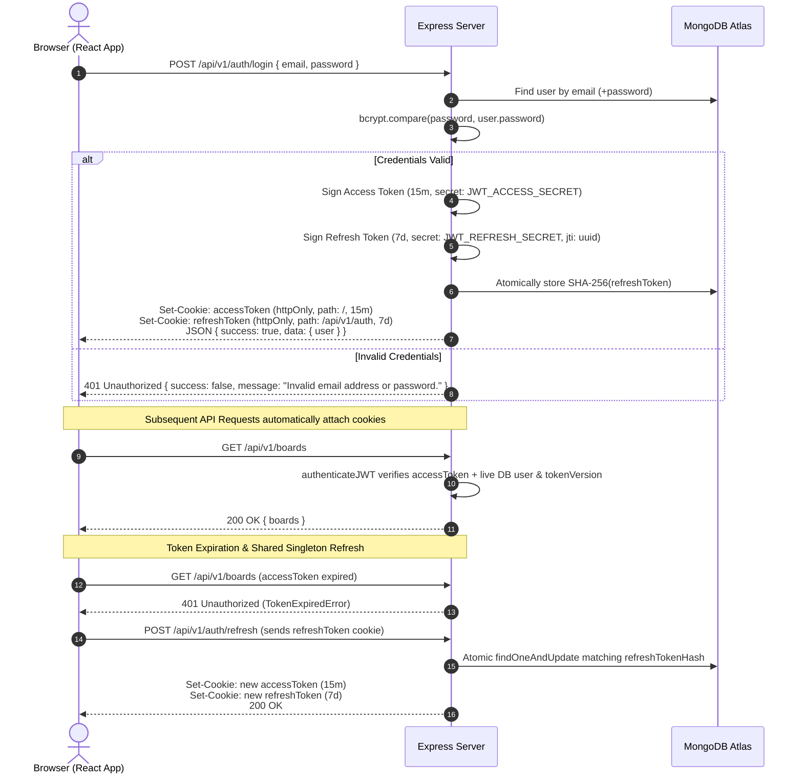

# Décora — Authentication & Security Architecture Specification

**Document Version:** 2.0.0 (Implemented & Verified)\
**Phase:** Phase 4, Day 12 — Authentication & User Management\
**Model:** Dual JWT (Access + Refresh) via HTTP-Only Cookies, Atomic MongoDB Rotation, Live Database Authorization, Origin Validation\

---

## 1. Threat Modeling & Security Objectives

Décora handles user credentials, personal design board collections, interior consultation inquiries, and administrative catalog controls.

### Primary Security Objectives:
1. **Prevent Credential & Token Theft (XSS Protection):** Never expose JWT access or refresh tokens to client-side JavaScript (`localStorage` or `sessionStorage`). All session tokens are stored strictly inside HTTP-only cookies.
2. **Mitigate Cross-Site Request Forgery (CSRF):** Use `SameSite=Lax` cookie flags, explicit CORS origin whitelisting, and strict Origin/Referer header validation on state-changing HTTP requests (`POST`, `PUT`, `PATCH`, `DELETE`).
3. **Prevent Unauthorized Data Access (Multi-Tenant Isolation):** Enforce strict resource ownership checks so a customer can never read, modify, or delete another customer's design boards, wishlists, or consultations.
4. **Prevent Brute-Force & Denial of Service Attacks:** Implement dedicated IP-based rate limiting on sensitive authentication routes (`/api/v1/auth/login`, `/api/v1/auth/register`).
5. **Secure Administrative Governance:** Isolate administrative capabilities behind live database role verification middleware (`requireAdmin`).

---

## 2. Password Hashing & Storage

User passwords are encrypted before persistence in MongoDB using **bcryptjs**:

```
Plaintext Password ──> [ bcrypt.genSalt(10) ] ──> [ bcrypt.hash(pass, salt) ] ──> Store in User.password
```

### Security Rules:
- **Complexity Requirement:** Minimum 8 characters, maximum 72 bytes, at least one letter, and at least one number.
- **No Silent Truncation / Modification:** Passwords must **never be trimmed** or altered; leading and trailing whitespace may be deliberate parts of passphrases. Passwords exceeding 72 bytes are rejected at the validator level to prevent bcrypt's silent 72-byte truncation vulnerability.
- **Salt Work Factor:** Configured via `env.BCRYPT_SALT_ROUNDS` (minimum 10 rounds, enforced in production).
- **Constant-Time Verification:** Verification uses `user.comparePassword(candidatePassword)` backed by `bcrypt.compare()`.
- **Query Protection:** The `password` field in the Mongoose schema is marked with `select: false`. It is never returned in ordinary queries or JSON serialization.

---

## 3. Dual-Token Architecture & Cookie Lifecycle

Décora employs a **Dual JWT Token** architecture with single-use refresh token rotation:



### Token Specifications:
| Token | Lifespan | Secret Variable | Claims | Storage Location |
|---|---|---|---|---|
| **Access Token** | 15 Minutes | `JWT_ACCESS_SECRET` | `{ id, role, tokenVersion, type: 'access' }` | Cookie: `accessToken`, `path: '/'` |
| **Refresh Token** | 7 Days | `JWT_REFRESH_SECRET` | `{ id, tokenVersion, type: 'refresh', jti: uuid }` | Cookie: `refreshToken`, `path: '/api/v1/auth'` |

### Cookie Security Attributes:
- **`accessToken`:** `httpOnly: true, secure: env.isProduction, sameSite: 'lax', maxAge: 15 * 60 * 1000, path: '/'`.
- **`refreshToken`:** `httpOnly: true, secure: env.isProduction, sameSite: 'lax', maxAge: 7 * 24 * 60 * 60 * 1000, path: '/api/v1/auth'`.
- **Matching Cookie Deletion:** When clearing cookies upon logout or refresh rejection, identical attributes and paths are passed to `res.clearCookie()` ensuring complete removal.

---

## 4. Single-Session Policy & Refresh Token Rotation

### Single-Session Policy
Each customer account maintains **one active refresh token session**:
- The `User` record stores `refreshTokenHash` (`select: false`).
- Logging in from a new client replaces `refreshTokenHash`, superseding the prior session.

### Atomic Rotation & Replay Protection
- Refresh tokens are hashed using SHA-256 (`crypto.createHash('sha256')`).
- Rotating a token uses an **atomic conditional update**:
  ```javascript
  const updatedUser = await User.findOneAndUpdate(
    { _id: user._id, refreshTokenHash: incomingHash, tokenVersion: decoded.tokenVersion, isActive: true },
    { $set: { refreshTokenHash: newRefreshHash } },
    { new: true }
  );
  ```
- **Concurrency Safety:** If concurrent refresh requests arrive, MongoDB's atomic document lock guarantees exactly one succeeds; the second receives HTTP 401.
- **Replay Invalidation:** If a validly signed token from the current `tokenVersion` is presented whose hash does not match the active hash, the server invalidates the session family by incrementing `tokenVersion` and nullifying `refreshTokenHash`.

---

## 5. Middleware Architecture & Access Control

### 5.1. `authenticateJWT`
- Extracts `accessToken` from `req.cookies.accessToken` (or `Authorization: Bearer <token>` fallback).
- Verifies signature, expiry, and `type === 'access'`.
- Queries MongoDB: `User.findById(decoded.id).select('email fullName role isActive tokenVersion')`.
- Validates that the user exists, `isActive === true`, and `decoded.tokenVersion === user.tokenVersion`.
- Attaches the **authoritative live database user** to `req.user`.

### 5.2. `requireAdmin`
- Enforces `req.user.role === 'admin'`.
- Because `req.user` is populated live from MongoDB, administrative privilege revocations take effect immediately.

### 5.3. `validateOrigin` (CSRF Protection)
- Inspects `POST`, `PUT`, `PATCH`, `DELETE` requests.
- Validates that `req.headers.origin` (or parsed `req.headers.referer`) matches `env.CLIENT_URL`.
- Combined with `SameSite=Lax` cookies, prevents third-party cross-origin state manipulation.

---

## 6. Rate Limiting & Denial-of-Service Defense

1. **Authentication Limiter (`/api/v1/auth/login`, `/api/v1/auth/register`):**
   - Window: 15 minutes.
   - Development limit: 100 requests per IP.
   - Production limit: 10 requests per IP.
   - Standardized HTTP 429 response envelope.
2. **General API Limiter (`/api/v1/*`):**
   - Window: 15 minutes.
   - Development limit: 1500 requests per IP; Production limit: 300 requests per IP.

---

## 7. Administrator Provisioning Utility

- **Zero Hardcoded Credentials:** Registration is strictly restricted to `customer` accounts.
- **CLI Provisioning:** Run `node server/scripts/seedAdmin.js <email> <password> [fullName]` (or set `ADMIN_EMAIL` and `ADMIN_PASSWORD` in `.env`).
- **Idempotence:** If an administrator account already exists with that email, the script logs the existing account and exits with code 0 without modifying credentials.
