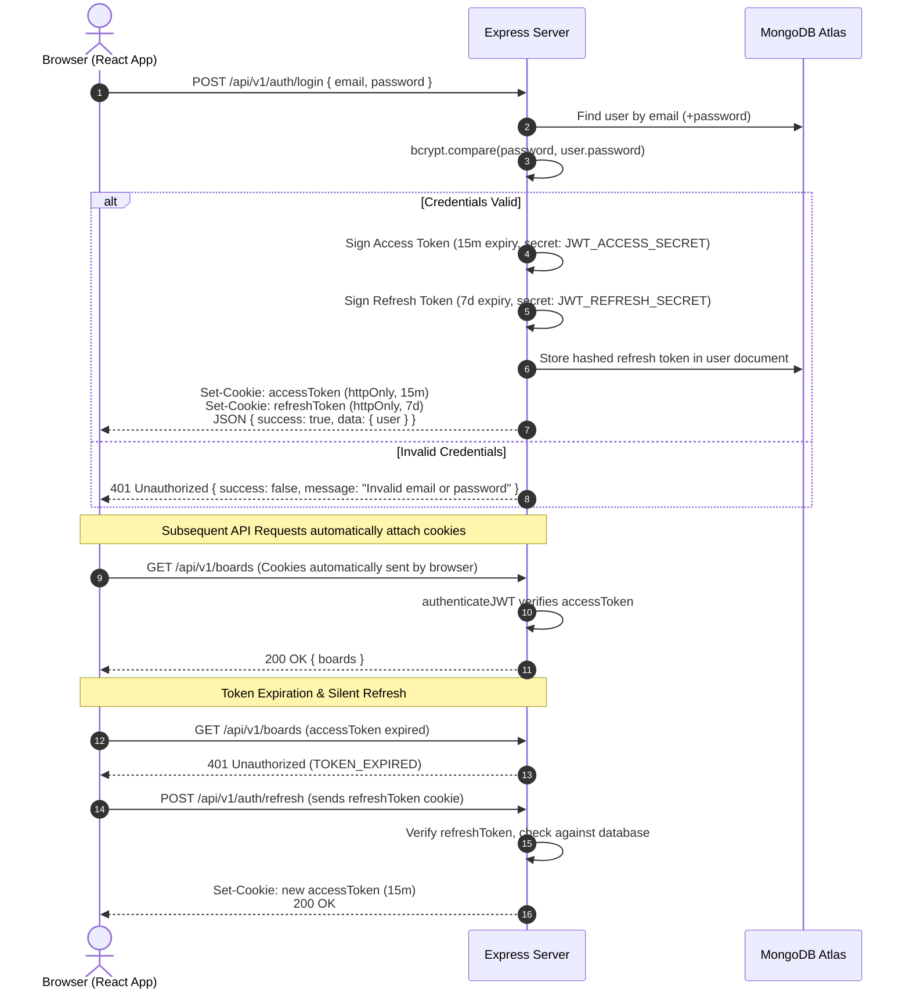

# Décora — Authentication & Security Architecture Specification

**Document Version:** 1.0.0  
**Phase:** Phase 4, Day 12 — Backend Architecture & API Contract Design  
**Model:** Dual JWT (Access + Refresh) via HTTP-Only Cookies, bcrypt, Express Middleware, RBAC  

---

## 1. Threat Modeling & Security Objectives

Décora handles user credentials, personal design board collections, interior consultation inquiries, and administrative catalog controls.

### Primary Security Objectives:
1. **Prevent Credential & Token Theft (XSS Protection):** Never expose JWT access or refresh tokens to client-side JavaScript (e.g. `localStorage` or `sessionStorage`). All session tokens are stored strictly inside HTTP-only cookies.
2. **Mitigate Cross-Site Request Forgery (CSRF):** Use `SameSite=Lax` cookie flags, explicit CORS origin whitelisting, and structured JSON payloads that cannot be submitted by simple HTML form elements.
3. **Prevent Unauthorized Data Access (Multi-Tenant Isolation):** Enforce strict resource ownership checks so a customer can never read, modify, or delete another customer's design boards, wishlists, or consultations by guessing or altering IDs.
4. **Prevent Brute-Force & Denial of Service Attacks:** Implement IP-based rate limiting on sensitive authentication routes (`/api/v1/auth/*`).
5. **Secure Administrative Governance:** Isolate administrative capabilities behind role verification middleware (`requireRole('admin')`).

---

## 2. Password Hashing & Storage

User passwords are encrypted before persistence in MongoDB using **bcrypt**:

```
Plaintext Password ──> [ bcrypt.genSalt(10) ] ──> [ bcrypt.hash(pass, salt) ] ──> Store in User.password
```

### Security Rules:
- **Salt Work Factor:** Minimum 10 rounds ($\approx 65\text{ms}$ computational delay per hash on modern CPUs).
- **Timing Attack Resistance:** Verification uses `bcrypt.compare()`, which executes in constant time regardless of where string mismatches occur.
- **Query Protection:** The `password` field in the Mongoose schema is marked with `select: false`. Any query (`User.findById()`, `User.find()`) omits the password hash by default unless explicitly requested with `.select('+password')` during login.

---

## 3. Dual-Token Architecture & Cookie Lifecycle

To balance security and customer usability, Décora employs a **Dual JWT Token** architecture.



### Token Specifications:

| Token | Lifespan | Secret Variable | Payload | Storage Location |
|---|---|---|---|---|
| **Access Token** | 15 Minutes | `JWT_ACCESS_SECRET` | `{ id: user._id, role: user.role }` | Cookie: `accessToken` |
| **Refresh Token** | 7 Days | `JWT_REFRESH_SECRET` | `{ id: user._id, version: user.tokenVersion }` | Cookie: `refreshToken` |

### Cookie Security Attributes:
When issuing tokens via `res.cookie()`, the following attributes are mandatory:

```javascript
const accessCookieOptions = {
  httpOnly: true,                                       // Inaccessible to document.cookie (prevents XSS theft)
  secure: process.env.NODE_ENV === 'production',        // Enforces HTTPS in production; allowed over HTTP in dev
  sameSite: 'lax',                                      // Protects against cross-site request forgery
  maxAge: 15 * 60 * 1000,                               // 15 minutes in milliseconds
  path: '/',
};

const refreshCookieOptions = {
  httpOnly: true,
  secure: process.env.NODE_ENV === 'production',
  sameSite: 'lax',
  maxAge: 7 * 24 * 60 * 60 * 1000,                      // 7 days in milliseconds
  path: '/api/v1/auth',                                 // Restricted path: only sent to auth routes
};
```

---

## 4. Cross-Origin Resource Sharing (CORS) Configuration

The server configures CORS strictly to allow only the trusted frontend origin with credentials:

```javascript
import cors from 'cors';

const corsOptions = {
  origin: process.env.CLIENT_URL || 'http://localhost:5173',
  credentials: true,                                    // Enables transmission of HTTP-only cookies
  methods: ['GET', 'POST', 'PUT', 'PATCH', 'DELETE', 'OPTIONS'],
  allowedHeaders: ['Content-Type', 'Authorization', 'X-Requested-With'],
  optionsSuccessStatus: 204,
};

app.use(cors(corsOptions));
```

> [!IMPORTANT]
> When `credentials: true` is enabled, the CORS standard strictly prohibits wildcard origins (`origin: '*'`). The origin **must** be an explicit string (e.g. `http://localhost:5173` or production domain).

---

## 5. Middleware Architecture & Access Control

### 5.1. Authentication Guard: `authenticateJWT`
- Intercepts requests on protected endpoints.
- Reads `req.cookies.accessToken` (or `Authorization: Bearer <token>` fallback).
- Verifies signature and expiration using `jwt.verify()`.
- Attaches authenticated user payload to `req.user = { _id, email, role }`.
- If missing or expired, halts execution and returns `401 Unauthorized`.

### 5.2. Role-Based Access Control: `requireRole(role)`
- Executes after `authenticateJWT`.
- Compares `req.user.role === role`.
- If mismatch (e.g., standard customer attempting to access `/api/v1/admin/*`), immediately halts execution and returns `403 Forbidden` (`{ message: "Access forbidden: administrative privileges required" }`).

### 5.3. Resource Ownership Guard: `verifyBoardOwnership`
- Prevents Insecure Direct Object References (IDOR).
- Inspects `req.params.id` (or `boardId`).
- Queries `DesignBoard.findById(req.params.id).select('userId')`.
- If board does not exist: returns `404 Not Found`.
- If `!board.userId.equals(req.user._id)` and `req.user.role !== 'admin'`: returns `403 Forbidden` (`{ message: "You do not have permission to access or modify this design board" }`).
- Caches the retrieved board instance on `req.board` to avoid redundant database round-trips in downstream controllers.

---

## 6. Rate Limiting & Denial-of-Service Defense

Using `express-rate-limit`, the server implements tiered rate limiting:

1. **Authentication Route Limiter (`/api/v1/auth/login`, `/api/v1/auth/register`):**
   - Window: 15 minutes.
   - Max attempts: 10 requests per IP address.
   - Response: `429 Too Many Requests` (`{ message: "Too many sign-in attempts. Please try again after 15 minutes." }`).
2. **General API Limiter (`/api/v1/*`):**
   - Window: 15 minutes.
   - Max attempts: 300 requests per IP address.
3. **Consultation Intake Limiter (`/api/v1/consultations`):**
   - Window: 1 hour.
   - Max submissions: 5 requests per IP address (mitigates contact spam from unauthenticated bots).

---

## 7. Input Validation & Injection Mitigation

All incoming request payloads are validated and sanitized prior to controller execution using `express-validator`:

- **SQL/NoSQL Injection Defense:** Mongoose schema casting and parameterized query builders inherently prevent NoSQL operator injection (`{ $gt: "" }`). Additionally, `mongo-sanitize` is applied as global middleware to strip leading `$` characters from user input keys.
- **XSS Defense:** String inputs (names, notes, board titles, descriptions) are trimmed and HTML special characters escaped.
- **Type Safety:** Dimensions, quantities, and coordinate inputs are strictly checked for numerical bounds (e.g. `quantity >= 1`, `roomLength >= 1.0 && roomLength <= 20.0`).

---

## 8. Safe Error Handling & Information Disclosure Prevention

The global error handling middleware guarantees that production environments never leak implementation details:

- **Mongoose CastError (Invalid ObjectId):** Formatted as `400 Bad Request` (`"Invalid resource identifier format"`), avoiding internal database stack traces.
- **Mongoose Duplicate Key Error (code 11000):** Formatted as `409 Conflict` (`"An account with this email address already exists"`).
- **Environment Gating:** Stack traces are included in error responses **only** when `process.env.NODE_ENV === 'development'`. In production, internal server errors return generic message: `"An unexpected architectural error occurred on the server. Please try again later."`
