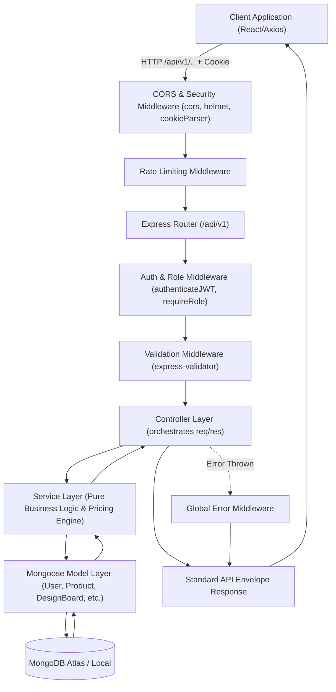

# Décora — Backend Architecture & System Design Specification

**Document Version:** 1.0.0  
**Phase:** Phase 4, Day 12 — Backend Architecture & API Contract Design  
**Target Runtime:** Node.js (>=18.x LTS), Express.js (>=4.19.x), MongoDB Atlas / Local MongoDB, Mongoose (>=8.x)  
**Standard Prefix:** `/api/v1`  
**Security Model:** Secure HTTP-Only Cookie Authentication, Dual JWTs, Role-Based Access Control (RBAC)  

---

## 1. System Vision & Architectural Principles

Décora is an architectural interior design and bespoke furniture customization platform. In Phases 1 through 3 (Days 5–11), the complete frontend foundation was engineered with React, Vite, Tailwind CSS, Lucide icons, an SVG-based 2D CAD Room Planner, and client-side service adapters.

In Phase 4 (Day 12 onwards), the backend is introduced as a robust, production-grade REST API server to provide persistent storage, authoritative pricing validation, customer identity management, and administrative governance.

### Core Architectural Principles:
1. **Frontend Non-Disruption & Stability:** The backend must interface smoothly with existing React contexts (`AuthContext`, `WishlistContext`, `DesignBoardContext`) and service adapters (`client/src/services/api.js`, `designBoardService.js`). Existing component interfaces, prop contracts, and data structures must be preserved.
2. **Server-Side Pricing Authority:** Pricing calculations must never trust values sent from the client. All custom configurations (fabrics, finishes, dimensions, and sizes) are re-validated and additively calculated on the server using an authoritative backend pricing service identical in logic to `client/src/utils/pricingEngine.js`.
3. **Defense-in-Depth Security:** Passwords hashed with bcrypt (cost factor $\ge 10$); JWTs stored strictly inside `httpOnly`, `sameSite: 'lax'`, `secure` cookies (no access tokens in `localStorage`); strict resource ownership middleware for design boards and wishlists; role guards for administrative endpoints.
4. **Clean Separation of Concerns (Layered Modular Architecture):** Strict partitioning across Configuration, Models, Routes, Controllers, Services, Middleware, Validators, and Utilities.
5. **Deterministic Data Modeling:** Data models in Mongoose must accurately reflect the complex nested snapshot structures of customizable furniture and 2D CAD floorplans created in Days 9, 10, and 11 without lossy flattening.

---

## 2. Technology Stack & Component Rationale

| Layer | Technology | Version | Rationale & Responsibility |
|---|---|---|---|
| **Runtime Environment** | Node.js | `>= 18.20.0 LTS` | High-throughput asynchronous event-driven I/O, native ES modules / CommonJS support, widespread deployment compatibility. |
| **HTTP Framework** | Express.js | `>= 4.19.2` | Lightweight, unopinionated, performant HTTP server framework with extensive middleware ecosystem. |
| **Database Engine** | MongoDB (Atlas / Local) | `>= 7.0` | Flexible JSON document store naturally suited for hierarchical furniture customization options, polymorphic snapshot arrays, and CAD floorplan coordinate arrays. |
| **Object Data Modeling (ODM)** | Mongoose | `>= 8.3.0` | Strict schema validation, middleware hooks (pre-save hashing), casting, reference population, and index management. |
| **Authentication & Tokens** | JSON Web Tokens (`jsonwebtoken`) | `>= 9.0.2` | Stateless cryptographic verification for access and refresh tokens. |
| **Password Hashing** | `bcryptjs` / `bcrypt` | `>= 2.4.3` | Cryptographically secure adaptive hashing with configurable work factor ($\ge 10$) resistant to GPU brute-force attacks. |
| **Cookie Parsing** | `cookie-parser` | `>= 1.4.6` | Signed and unsigned HTTP cookie parsing for seamless reading of `httpOnly` JWT tokens. |
| **CORS Middleware** | `cors` | `>= 2.8.5` | Cross-Origin Resource Sharing with explicit origin whitelisting (`http://localhost:5173`) and `credentials: true`. |
| **Security Headers** | `helmet` | `>= 7.1.0` | HTTP security headers (X-Content-Type-Options, Frameguard, Referrer-Policy). |
| **Rate Limiting** | `express-rate-limit` | `>= 7.2.0` | Rate limiting per IP to prevent brute-force attacks on auth routes and denial of service. |
| **Validation Layer** | `express-validator` | `>= 7.0.1` | Declarative schema-based request validation and sanitization prior to controller execution. |

---

## 3. Directory & Folder Architecture

The server codebase will reside in `server/` at the root of the repository, decoupled from `client/`:

```
Decora/
├── client/                           # Existing React + Vite Frontend
│   ├── src/
│   │   ├── context/                  # AuthContext, WishlistContext, DesignBoardContext
│   │   ├── services/                 # api.js, designBoardService.js
│   │   ├── utils/                    # pricingEngine.js, formatters.js
│   │   └── ...
├── server/                           # Node.js + Express + MongoDB Backend
│   ├── src/
│   │   ├── config/                   # Environment & Database Configuration
│   │   │   ├── db.js                 # Mongoose connection with retry & fallback
│   │   │   └── env.js                # Validated environment variables
│   │   ├── models/                   # Mongoose Schemas & Models
│   │   │   ├── User.js               # Customer & Admin accounts
│   │   │   ├── Product.js            # Furniture catalog & customizer matrices
│   │   │   ├── Wishlist.js           # Customer saved product references
│   │   │   ├── DesignBoard.js        # Multi-board snapshots & room layouts
│   │   │   └── Consultation.js       # Design consultation inquiries & pipeline
│   │   ├── routes/                   # Express Router Mount Points (/api/v1)
│   │   │   ├── index.js              # Central v1 route aggregator
│   │   │   ├── authRoutes.js         # /api/v1/auth
│   │   │   ├── productRoutes.js      # /api/v1/products
│   │   │   ├── wishlistRoutes.js     # /api/v1/wishlist
│   │   │   ├── boardRoutes.js        # /api/v1/boards
│   │   │   ├── consultationRoutes.js # /api/v1/consultations
│   │   │   └── adminRoutes.js        # /api/v1/admin
│   │   ├── controllers/              # HTTP Request/Response Orchestrators
│   │   │   ├── authController.js     # Register, Login, Logout, Current User
│   │   │   ├── productController.js  # Catalog filtering, search, detail, options
│   │   │   ├── wishlistController.js # Toggle, sync, clear
│   │   │   ├── boardController.js    # Boards CRUD, snapshots, room layout
│   │   │   ├── consultationController.js # Guest/Customer intake & retrieval
│   │   │   └── adminController.js    # Product CRUD, consultation pipeline status
│   │   ├── services/                 # Pure Business Logic Layer
│   │   │   ├── authService.js        # Token generation, user creation, credentials verification
│   │   │   ├── pricingService.js     # Authoritative option validation & price calculation
│   │   │   ├── boardService.js       # Board aggregation, snapshot creation, budget recalculation
│   │   │   └── consultationService.js # Reference code generation, pipeline transitions
│   │   ├── middleware/               # Express Request Interceptors
│   │   │   ├── authMiddleware.js     # authenticateJWT (reads cookie)
│   │   │   ├── roleMiddleware.js     # requireRole('admin')
│   │   │   ├── ownershipMiddleware.js # verifyBoardOwnership, verifyResourceOwnership
│   │   │   ├── errorMiddleware.js    # Centralized error handler & formatting
│   │   │   └── rateLimitMiddleware.js# Per-route brute-force protection
│   │   ├── validators/               # Input Sanitization & Request Validation Rules
│   │   │   ├── authValidators.js     # Register, login rule sets
│   │   │   ├── boardValidators.js    # Board metadata, snapshot, room layout validation
│   │   │   └── consultationValidators.js # Contact info, metric dimension validation
│   │   ├── utils/                    # Reusable Server Utilities
│   │   │   ├── apiResponse.js        # Standardized { success, data, message } envelope
│   │   │   ├── apiError.js           # Custom AppError extending Error with statusCode
│   │   │   ├── constants.js          # Room types, styles, consultation statuses
│   │   │   └── referenceCode.js      # Formatted reference code generator (DEC-YYYY-XXXX)
│   │   ├── scripts/                  # Standalone Operational Scripts
│   │   │   └── seed.js               # Database seeder populating products & admin account
│   │   ├── app.js                    # Express Application assembly (middleware, routes)
│   │   └── server.js                 # HTTP listener & cluster initialization
│   ├── .env.example                  # Documented environment variables template
│   └── package.json                  # Server dependencies & scripts
└── docs/                             # Architecture & Project Documentation
```

---

## 4. Layer Responsibilities & Data Flow



### Detailed Layer Specifications:

1. **Configuration Layer (`src/config/`)**:
   - `db.js`: Establishes the Mongoose connection with auto-reconnection and exponential backoff. Supports fallback from MongoDB Atlas (`MONGODB_URI`) to local MongoDB (`mongodb://127.0.0.1:27017/decora`).
   - `env.js`: Validates all required environment variables at startup (`PORT`, `MONGODB_URI`, `JWT_ACCESS_SECRET`, `JWT_REFRESH_SECRET`, `CLIENT_URL`), failing immediately if critical keys are absent.

2. **Routes Layer (`src/routes/`)**:
   - Pure routing declarations. Maps HTTP verbs and paths to middleware chains and controller handlers.
   - All routes prefixed with `/api/v1`.

3. **Middleware Layer (`src/middleware/`)**:
   - `authenticateJWT`: Extracts access token from signed `httpOnly` cookie or `Authorization: Bearer` header. Verifies signature; populates `req.user`.
   - `requireRole(role)`: Validates `req.user.role === role`.
   - `verifyBoardOwnership`: Intercepts `/api/v1/boards/:id/*` requests, verifies `board.userId.equals(req.user._id)`.
   - `errorMiddleware`: Captures all thrown errors, handles Mongoose CastErrors / ValidationErrors / duplicate key errors, logs details in development, and returns standardized JSON.

4. **Validators Layer (`src/validators/`)**:
   - Uses `express-validator` chains to sanitize strings, trim inputs, enforce email formatting, check password length, and validate snapshot structures prior to executing controller logic.

5. **Controllers Layer (`src/controllers/`)**:
   - Pure HTTP abstraction: reads `req.params`, `req.query`, `req.body`, and `req.user`. Invokes services. Returns HTTP status and standardized response JSON via `apiResponse.js`. Never executes direct database operations.

6. **Services Layer (`src/services/`)**:
   - Encapsulates domain logic. For example:
     - `pricingService`: Validates option compatibility, recalculates configured unit prices strictly from database options.
     - `boardService`: Recalculates estimated board budget across snapshot items, manages snapshot quantity increments, and serializes room layouts.
     - `authService`: Issues paired access and refresh tokens, sets HTTP-only cookies with correct security flags.

7. **Models Layer (`src/models/`)**:
   - Mongoose schemas defining collection contracts, field types, validations, default values, pre-save hooks, indexes, virtuals, and subdocuments.

---

## 5. Standardized API Response & Error Envelope

All API endpoints will return a predictable JSON envelope, ensuring client-side interceptors can handle outcomes reliably.

### Success Envelope Structure (`200 OK`, `201 Created`):
```json
{
  "success": true,
  "statusCode": 200,
  "message": "Design board retrieved successfully",
  "data": { ... },
  "meta": {
    "totalCount": 1,
    "timestamp": "2026-11-18T10:00:00.000Z"
  }
}
```

### Error Envelope Structure (`400`, `401`, `403`, `404`, `409`, `422`, `500`):
```json
{
  "success": false,
  "statusCode": 404,
  "message": "Design board 'board-1794939941168-819' not found",
  "errors": [
    {
      "field": "boardId",
      "message": "The specified design board does not exist or has been removed."
    }
  ],
  "meta": {
    "timestamp": "2026-11-18T10:00:00.000Z"
  }
}
```

---

## 6. Environmental Configuration & Secrets

The backend requires the following configuration in `server/.env`:

| Key | Default / Example | Purpose |
|---|---|---|
| `PORT` | `5000` | Port Express listens on. |
| `NODE_ENV` | `development` / `production` | Controls cookie `secure` flag, stack traces in errors. |
| `CLIENT_URL` | `http://localhost:5173` | Whitelisted origin for CORS and credentials. |
| `MONGODB_URI` | `mongodb://127.0.0.1:27017/decora` | MongoDB Atlas or local connection string. |
| `JWT_ACCESS_SECRET` | `[64-char hex string]` | Secret for signing 15-minute access JWTs. |
| `JWT_REFRESH_SECRET`| `[64-char hex string]` | Secret for signing 7-day refresh JWTs. |
| `COOKIE_SECRET` | `[64-char hex string]` | Secret for signing cookie values. |
| `BCRYPT_SALT_ROUNDS`| `10` | Work factor for bcrypt password hashing. |
| `SEED_ADMIN_EMAIL` | `admin@decora.interior` | Default seeded administrator account. |
| `SEED_ADMIN_PASS` | `DecoraAdmin2026!` | Default seeded administrator password. |

> [!CAUTION]
> Never commit `server/.env` to source control. A `server/.env.example` file with empty dummy values is maintained in the repository for developer onboarding.
