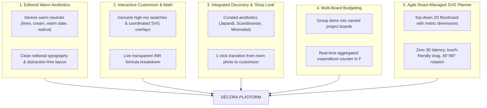

# Décora – Phase 1: Competitor Research & Gap Analysis (Day 2)

**Document Version:** 1.0.0  
**Phase:** Phase 1 (Research & Gap Analysis)  
**Academic Subject:** Frontend Web Development (Primary Focus)  
**Standardized Conventions:** Currency in INR (₹), Metric units (cm / m), API prefix `/api/v1`  
**Benchmarked Competitors:** IKEA, Pepperfry, Urban Ladder, West Elm

---

## 1. Executive Summary

To establish an exceptional frontend user experience for **Décora**, Phase 1 investigated four major industry benchmarks spanning global retail giants, Indian furniture marketplaces, and high-end design houses.

While current market platforms excel in specific silos—IKEA in modular breadth, Pepperfry in catalog volume, Urban Ladder in solid wood craft, and West Elm in aspirational styling—they exhibit noticeable friction points:
1. **Separation of Inspiration and Action:** Inspiration galleries rarely transition smoothly into customized product selections or spatial planning.
2. **Aggressive Commercial Noise vs. Editorial Calm:** Commercial Indian marketplaces suffer from banner overload, pop-ups, and countdown timers that degrade design immersion.
3. **Opaque or Gated Customization:** Customization is either locked behind offline appointments (Pepperfry, Urban Ladder) or conceals the mathematical logic behind price surges (West Elm).
4. **Over-Engineered Spatial Planners:** 3D planners (IKEA Kreativ, West Elm Room Planner) are computationally heavy, difficult to control on mobile viewports, and carry steep learning curves.

**Décora's Strategic Opportunity:** Unify discovery, authentic customization with transparent INR (₹) price calculations, thematic design boards with aggregated budgets, and a lightweight React-managed SVG 2D room planner within a clean, warm architectural aesthetic.

---

## 2. Competitor Comparison Matrix

| Evaluation Dimension | IKEA (India) | Pepperfry | Urban Ladder | West Elm | Décora (Target Architecture) |
|---|---|---|---|---|---|
| **Primary Market / Aesthetic** | Global Scandinavian; Functional & mass-market. | Indian marketplace; Multi-brand, promotion-heavy. | Curated Indian contemporary; Solid wood & space-saving. | Global high-end modern; Aspirational & editorial. | **Warm Architectural Modern; Editorial, tactile & serene.** |
| **Visual Hierarchy & Tone** | Clean, grid-based, utilitarian corporate blue/yellow. | High visual clutter; commercial sales badges & pop-ups. | Polished, clean catalog cards; balanced whitespace. | Premium editorial; serif headers, rich neutral tones. | **Warm neutrals (linen, cream, rich walnut, matte metal).** |
| **Catalog & Navigation** | Mega-menus by room and product; thousands of SKUs. | Dense multi-tier dropdowns; faceted brand filters. | Streamlined categories; room-centric collections. | Curated by room and aesthetic lookbooks; refined menus. | **Faceted category filters + mobile drawer navigation.** |
| **Search & Filtering** | Fast real-time suggestions; multi-attribute filters. | Granular filters (wood type, brand, discounts, EMI). | Clear filters for wood finish, room, and dimensions. | Curated filters by material, fabric grade, and size. | **Instant text search, material chips, INR price slider.** |
| **Product Detail Page (PDP)** | Modular exploded views, packaging specs, assembly PDFs. | Promotion badges, EMI calculator, pin-code delivery check. | 360° product views, dimension diagrams, wood care notes. | Rich fabric galleries, lifestyle imagery, styling tips. | **Multi-angle gallery, metric specs ($cm$, $kg$), direct customizer.** |
| **Customization Experience** | Modular system builders (PAX, BESTÅ); rigid colorways. | Customization delegated to offline Studio consultations. | Limited online variants (2–3 fixed wood/fabric shades). | Extensive fabric & finish swatches; free physical swatches. | **Interactive swatches, authentic SVG overlays, instant INR formula.** |
| **Pricing Transparency** | Fixed flat pricing; modular parts added separately. | Complicated discounted pricing, coupon pop-ups, dynamic EMIs. | Transparent base pricing; limited variable pricing. | Pricing varies drastically by fabric grade without formula clarity. | **Transparent dynamic formula:** $\text{Base} + \Delta\text{Mat} + (\text{Size} \times \text{Base})$. |
| **Inspiration & "Shop the Look"** | Extensive "Rooms" portal; clickable hotspots on photos. | Static curated living room galleries with linked items. | "Home Interiors" lookbooks; primarily offline execution. | "Room Ideas" lookbooks categorized by aesthetic themes. | **Curated styles (Japandi, Scandinavian) with 1-click catalog links.** |
| **Wishlist & Saving** | Flat shopping lists; no moodboard budget aggregation. | Basic "Shortlist" heart icon; no multi-board organization. | Simple wishlist; no spatial or budget aggregation. | "Favorites" list; shareable with Design Crew stylists. | **Thematic Design Boards with live aggregated budget in ₹.** |
| **Room Planning Tool** | *IKEA Kreativ* (3D LiDAR/web scan); heavy & app-centric. | In-store 3D consultant renders; no self-service tool. | Professional 3D consultation; no consumer web planner. | Web 3D room planner; heavy memory usage, desktop-centric. | **Lightweight React-managed SVG 2D Canvas with live ₹ tally.** |
| **Consultation Journey** | Online booking for in-store kitchen/wardrobe planning. | "Studio Pepperfry" booking for physical store visits. | "Home Interiors" consultation booking form. | "Design Crew" free virtual/in-store appointments. | **Dual intake: Instant guest request + Account-linked customer flow.** |

---

## 3. Individual Competitor Deep Dives

### 3.1. IKEA India
- **Website URL:** [ikea.com/in/en/](https://www.ikea.com/in/en/)
- **Room Inspiration Hub:** [ikea.com/in/en/rooms/](https://www.ikea.com/in/en/rooms/)
- **Planners & Design Tools:** [ikea.com/in/en/planners/](https://www.ikea.com/in/en/planners/)

#### Detailed Findings & Strengths
- **Exemplary Information Architecture:** Hierarchical taxonomy categorized by both functional product type (*Chairs $\rightarrow$ Armchairs*) and contextual room (*Living Room $\rightarrow$ Seating*).
- **"Shop the Look" Interactivity:** Rooms feature interactive hotspot pins overlaid on high-resolution room photography. Clicking a pin reveals an instant mini-card with title, price in INR, and quick-add actions.
- **Dimensional Transparency:** Unmatched technical transparency providing exact package dimensions, net weights, and downloadable assembly instruction manuals.

#### Usability Friction Points & Documented Limitations
- **Overwhelming Catalog Density:** For customers seeking curated design rather than utility, browsing through thousands of basic items creates cognitive fatigue.
- **Utilitarian Visual Aesthetic:** High contrast, bright corporate styling lacks the warmth, tactile textures, and luxury ambience of high-end interior platforms.
- **Heavy, Fragile 3D Tools:** Tools like *IKEA Kreativ* require WebGL, high network bandwidth, and significant client memory, often lagging or crashing on mid-range laptops and mobile web browsers.
- **No Unified Moodboard Budgeting:** Shopping lists do not calculate room-level aesthetic grouping or combine customized variants into thematic boards.

---

### 3.2. Pepperfry
- **Website URL:** [pepperfry.com](https://www.pepperfry.com/)
- **Modular Design & Studios:** [pepperfry.com/studios.html](https://www.pepperfry.com/studios.html)

#### Detailed Findings & Strengths
- **Deep Alignment with Indian Buyers:** Clear categorization around solid woods valued in India (Sheesham, Teak, Mango Wood), alongside prominent No-Cost EMI and festive promotions.
- **Granular Sidebar Filtering:** Industry-leading filter granularity allowing users to filter by specific height, width, and depth brackets, material types, brands, and price sliders.
- **Omnichannel Synergy:** Smooth transition from online browsing to physical "Studio Pepperfry" experience centers where buyers can touch fabric swatches and inspect wood grains.

#### Usability Friction Points & Documented Limitations
- **Severe Commercial Clutter:** Intrusive marketing banners, countdown timers ("Hurry, Sale Ends in 2 hrs!"), coupon pop-ups, and spin-the-wheel gamification degrade trust and visual elegance.
- **Fragmented Marketplace Experience:** Because Pepperfry acts as a multi-vendor marketplace, product photography styles vary wildly between vendors, resulting in inconsistent lighting, resolution, and detail standards.
- **Disconnected Customization:** True customization cannot be executed directly on the web application. Customers seeking custom dimensions or upholstery modifications are redirected to offline store visits or telephone callbacks.
- **Basic Wishlist:** The "Shortlist" is a flat, unorganized bookmark queue with zero capability to group items by room or track combined renovation budgets.

---

### 3.3. Urban Ladder
- **Website URL:** [urbanladder.com](https://www.urbanladder.com/)
- **Collections & Interiors:** [urbanladder.com/interiors](https://www.urbanladder.com/interiors)

#### Detailed Findings & Strengths
- **Clean Aesthetic & High-Resolution Presentation:** Significantly more serene and curated than Pepperfry. Warm photography, consistent product card ratios, and minimal aggressive marketing banners.
- **Space-Saving & Dual-Purpose Focus:** Excellent communication of compact urban living solutions (e.g., hydraulic storage beds, nesting coffee tables, fold-away desks).
- **Comprehensive Specification Tables:** Clear material disclosures (solid wood vs. engineered veneer), weight capacity ratings, and warranty information.

#### Usability Friction Points & Documented Limitations
- **Rigid Product Configurations:** Most freestanding furniture pieces are available only in 1 or 2 static wood finishes (e.g., Teak vs. Mahogany). Interactive customization with real-time price updates is non-existent.
- **Static Inspiration Lookbooks:** Inspiration galleries present appealing room designs but lack interactive hotspot tagging; users must manually search the catalog to find the items featured in the photos.
- **Gated Interior Planning:** Spatial planning and 3D floor plan layouts are restricted to full-service interior consulting clients; self-service room planning is completely absent for regular buyers.

---

### 3.4. West Elm
- **Website URL:** [westelm.com](https://www.westelm.com/)
- **Room Inspiration Ideas:** [westelm.com/pages/ideas-and-advice/](https://www.westelm.com/pages/ideas-and-advice/)
- **Design Crew & Services:** [westelm.com/pages/design-crew/](https://www.westelm.com/pages/design-crew/)

#### Detailed Findings & Strengths
- **Gold Standard in Editorial Visual Design:** Sophisticated typography, editorial layout grids, natural lighting, and tactile texture photography (bouclé, slub velvet, white oak, brushed brass).
- **Exceptional Upholstery Customizer:** Customers can select between 30+ fabric swatches categorized by lifestyle grades (performance, pet-friendly, velvet, linen).
- **Curated Thematic Lookbooks:** Lookbooks organized around distinct modern aesthetics (*Japandi, Warm Modern, Relaxed Coastal, Mid-Century Modern*) that resonate with contemporary design enthusiasts.

#### Usability Friction Points & Documented Limitations
- **Opaque Pricing Structure:** Selecting different fabric grades alters the final price dramatically, but the site provides no breakdown or explanation of how the price was derived.
- **Heavy 3D Room Planner:** The web-based 3D room planner takes upwards of 15–20 seconds to load, requires extensive mouse navigation (orbit, pan, tilt), and is virtually unusable on mobile touchscreens.
- **High Friction for International Customers:** Heavy USD focus and shipping constraints make the direct platform less applicable to Indian domestic requirements without localized pricing and metric dimensions.

---

## 4. Feature Gap Analysis

The competitive landscape reveals significant unaddressed user needs that Décora can capitalize on:

```
┌────────────────────────────────────────────────────────────────────────────────────────┐
│                               FEATURE GAP MATRIX                                       │
├───────────────────────────────┬───────────┬──────────────┬──────────────┬──────────────┤
│ Feature Capability            │ IKEA      │ Pepperfry    │ Urban Ladder │ West Elm     │
├───────────────────────────────┼───────────┼──────────────┼──────────────┼──────────────┤
│ Editorial Warm Visual Design  │ ❌ Low    │ ❌ Low       │ ⚠️ Moderate  │ ✅ Excellent │
│ Transparent Dynamic Pricing   │ ⚠️ Fixed  │ ❌ Opaque    │ ❌ Fixed     │ ❌ Opaque    │
│ Real-Time Swatch Overlays     │ ❌ Modular│ ❌ None      │ ❌ Limited   │ ✅ Yes       │
│ Thematic Moodboard Budgets    │ ❌ None   │ ❌ None      │ ❌ None      │ ❌ None      │
│ Lightweight 2D Room Planner   │ ❌ 3D Only│ ❌ None      │ ❌ None      │ ❌ 3D Only   │
│ Dual Consultation Intake      │ ⚠️ Account│ ⚠️ Store Form│ ⚠️ Lead Form │ ⚠️ Appt Form │
│ INR Metric Specifications     │ ✅ Yes    │ ✅ Yes       │ ✅ Yes       │ ❌ No (USD)  │
└───────────────────────────────┴───────────┴──────────────┴──────────────┴──────────────┘
```

### Key Gaps Identified:
1. **The "Customizer Math" Gap:** No competitor transparently shows how material selections impact cost. Customers are left confused why a chair jumped in price when choosing bouclé or walnut.
2. **The "Room Budgeting" Gap:** Current platforms allow saving items to a generic wishlist, but fail to aggregate costs by room theme. Homeowners cannot see: *"What will this complete Japandi living room setup cost in total?"*
3. **The "Heavy Planner" Gap:** 3D WebGL planners alienate non-technical users and mobile shoppers. There is no simple, lightweight 2D top-down planner where users can drag, rotate, and check dimensions in seconds.
4. **The "Commercial Clutter" Gap:** Indian platforms (Pepperfry) sacrifice aesthetic beauty for aggressive sales prompts, while luxury platforms (West Elm) feel distant and inaccessible.

---

## 5. Décora Strategic Differentiation Blueprint

Within our **14-day academic timeline**, Décora will execute five strategic differentiators tailored for maximum frontend impact:



---

## 6. Recommended Frontend Features & UI Decisions

Based on competitor evidence, the following UI patterns and architectural specifications are recommended for Phase 2 (UI/UX Design) and Phase 3 (React Foundation):

### 6.1. Navigation & Header
- **Pattern:** Sticky frosted-glass navbar with warm backdrop blur (`backdrop-blur-md bg-stone-50/80`).
- **Elements:** Minimal brand wordmark, clear category links (*Inspiration, Catalog, Customizer, Room Planner, Design Boards*), active wishlist indicator with badge count, and profile drawer.
- **Mobile Drawer:** Full-height slide-over drawer with oversized, touch-friendly typography avoiding nested multi-level accordion fatigue.

### 6.2. Catalog & Discovery Grid
- **Filtering System:** Sticky left-sidebar on desktop, sliding bottom sheet on mobile.
- **Facet Controls:**
  - Room Type buttons (*Living, Bedroom, Dining, Office*).
  - Material pills with subtle visual texture hints (*Solid Oak, Walnut, Bouclé, Linen, Matte Metal*).
  - Dynamic dual-thumb INR (₹) price range slider.
  - Multi-criteria sorting dropdown (*Price: Low to High, Price: High to Low, Popularity*).
- **Product Card Architecture:** 4:5 portrait aspect ratio, subtle elevation hover transitions, quick-save wishlist heart toggle, starting price in INR, and "Customize" shortcut.

### 6.3. Product Detail Page (PDP)
- **Visuals:** Two-column layout: Sticky multi-image gallery on the left; structured purchase/spec column on the right.
- **Information Hierarchy:**
  1. Title, Style Tag, Category, and Base Price in INR (₹).
  2. Quick material preview swatches.
  3. Prominent CTA: Primary "Customize This Piece" + Secondary "Add to Design Board".
  4. Metric Specifications Table ($W \times D \times H\text{ cm}$, Weight in $kg$).
  5. Craftsmanship & Care instructions.
  6. "Complete the Look" related products slider.

### 6.4. Furniture Customizer Engine
- **Layout:** Split view—interactive product stage on the left; configuration panel on the right.
- **Variant Selectors:**
  - Fabric swatches (tactile texture representations).
  - Wood/Metal finish buttons with realistic color representations.
  - Dimension toggles (Compact, Standard, Grand).
- **Formula Breakdown Card:**
  $$\text{Total (₹)} = \underbrace{\text{Base}}_{\text{e.g., ₹28,000}} + \underbrace{\Delta\text{Fabric}}_{\text{e.g., +₹3,500}} + \underbrace{\Delta\text{Finish}}_{\text{e.g., +₹2,000}} + \underbrace{\Delta\text{Size}}_{\text{e.g., +₹4,000}} = \mathbf{₹37,500}$$
- **State Controls:** Instant "Reset to Defaults" button and "Save to My Designs" action.

### 6.5. React-Managed SVG 2D Room Planner
- **Canvas System:** Declarative SVG floorboard bounded by user-defined room dimensions in meters ($L \times W\text{ m}$).
- **Palette Sidebar:** Architectural top-down 2D furniture vector blocks (Sofas, Armchairs, Dining Tables, Beds, Rugs).
- **Interactions:**
  - Native SVG drag-and-drop placement.
  - Click to select with rotational handles (45° and 90° increments).
  - Delete item button.
  - Floating status bar with real-time room furniture count and aggregate room budget in INR (₹).

### 6.6. Personal Design Boards
- **Card-Based Moodboards:** Users can create boards like "Master Bedroom Japandi" or "Balcony Refresh".
- **Aggregated Budget Tally:** Prominent header showing total combined cost across all items in the board.
- **Export / Consultation Action:** One-click option to attach an active board to a Design Consultation request.

---

## 7. Sources & Reference URLs

1. **IKEA India:**
   - Official Store: [ikea.com/in/en/](https://www.ikea.com/in/en/)
   - Room Ideas & Inspiration: [ikea.com/in/en/rooms/](https://www.ikea.com/in/en/rooms/)
   - Online Design Planners: [ikea.com/in/en/planners/](https://www.ikea.com/in/en/planners/)
2. **Pepperfry:**
   - Official Marketplace: [pepperfry.com](https://www.pepperfry.com/)
   - Studios & Offline Centers: [pepperfry.com/studios.html](https://www.pepperfry.com/studios.html)
3. **Urban Ladder:**
   - Official Store: [urbanladder.com](https://www.urbanladder.com/)
   - Full Interior Solutions: [urbanladder.com/interiors](https://www.urbanladder.com/interiors)
4. **West Elm:**
   - Official Catalog: [westelm.com](https://www.westelm.com/)
   - Design Crew Consultations: [westelm.com/pages/design-crew/](https://www.westelm.com/pages/design-crew/)
   - Room Ideas & Lookbooks: [westelm.com/pages/ideas-and-advice/](https://www.westelm.com/pages/ideas-and-advice/)
