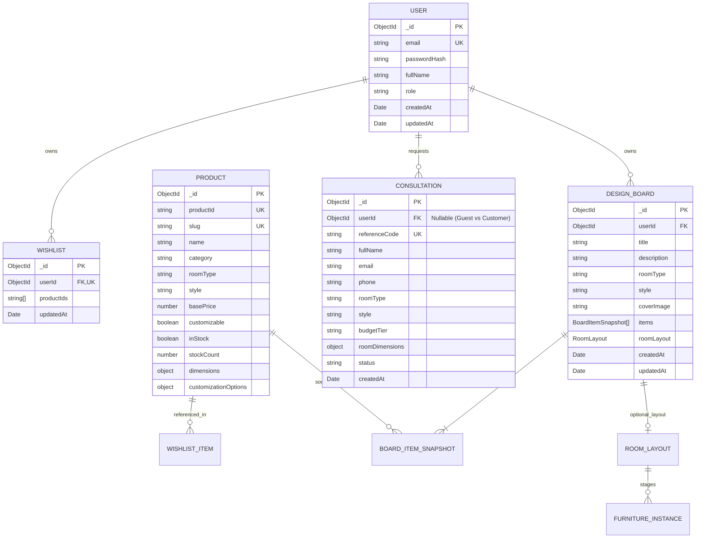

# Décora — Database Schema & Data Models Specification

**Document Version:** 1.0.0  
**Phase:** Phase 4, Day 12 — Backend Architecture & API Contract Design  
**Target Engine:** MongoDB (Mongoose ODM v8)  
**Conventions:** Metric system ($cm$, $m$, $kg$), INR ($₹$), ISO-8601 Timestamps, Compound Indexes for Multi-Tenant User Isolation  

---

## 1. Schema Design Principles

The database design for Décora reconciles high-performance catalog querying with the complex, hierarchical snapshot data structures created during frontend customization (Day 9), 2D spatial CAD planning (Day 10), and virtual moodboards (Day 11).

### Key Rules:
1. **Snapshot Immutability:** When a customized piece or standard piece is saved to a design board, the record represents an immutable snapshot of that configuration and its price at that moment. It does **not** rely on dynamic joins with the catalog that would retroactively alter the customer's design or budget if the base product changes later.
2. **Deterministic Instance Independence:** On floorplans and design boards, multiple instances of the same product ID (e.g. `sofa-sylvan`) must maintain their own distinct coordinates, rotations, fabric selections, timber finishes, dimensions, and unit prices.
3. **Strict Validation & Typing:** Enforces string enums, non-negative numbers, required reference integrity, and unique constraints.

---

## 2. Entity-Relationship Model



---

## 3. Data Model Specifications

### 3.1. User Model (`src/models/User.js`)

Represents registered customers and administrative staff.

```javascript
const userSchema = new mongoose.Schema(
  {
    email: {
      type: String,
      required: [true, 'Email address is required'],
      unique: true,
      lowercase: true,
      trim: true,
      match: [/^\S+@\S+\.\S+$/, 'Please provide a valid email address'],
      index: true,
    },
    password: {
      type: String,
      required: [true, 'Password is required'],
      minlength: [6, 'Password must be at least 6 characters'],
      select: false, // Omitted by default in queries for security
    },
    fullName: {
      type: String,
      required: [true, 'Full name is required'],
      trim: true,
      maxlength: [100, 'Name cannot exceed 100 characters'],
    },
    role: {
      type: String,
      enum: {
        values: ['customer', 'admin'],
        message: '{VALUE} is not a valid user role',
      },
      default: 'customer',
      index: true,
    },
    refreshTokenHash: {
      type: String,
      select: false, // For revoking sessions
    },
  },
  {
    timestamps: true,
    toJSON: {
      transform(doc, ret) {
        delete ret.password;
        delete ret.refreshTokenHash;
        delete ret.__v;
        return ret;
      },
    },
  }
);
```

- **Indexes:**
  - `email`: Unique index (`{ email: 1 }`, unique: true)
  - `role`: Index for admin filtering (`{ role: 1 }`)
- **Hooks:** Pre-save middleware to hash `password` with bcrypt if modified.
- **Methods:** `comparePassword(candidatePassword)` returning a Promise boolean.

---

### 3.2. Product Model (`src/models/Product.js`)

Central furniture catalog registry matching `client/src/data/products.js`.

```javascript
// Subdocument: Customization Option (Fabric, Finish, Size)
const optionItemSchema = new mongoose.Schema(
  {
    id: { type: String, required: true },
    name: { type: String, required: true },
    delta: { type: Number, required: true, default: 0 },
    colorHex: { type: String, match: /^#([0-9A-Fa-f]{3}|[0-9A-Fa-f]{6})$/ },
    texture: { type: String },
    scaleFactor: { type: Number, default: 1.0 },
  },
  { _id: false }
);

const productSchema = new mongoose.Schema(
  {
    productId: {
      type: String,
      required: [true, 'Unique product ID is required'],
      unique: true,
      trim: true,
      index: true,
    },
    slug: {
      type: String,
      required: [true, 'URL slug is required'],
      unique: true,
      trim: true,
      lowercase: true,
      index: true,
    },
    name: {
      type: String,
      required: [true, 'Product name is required'],
      trim: true,
      index: 'text',
    },
    category: {
      type: String,
      required: [true, 'Category is required'],
      enum: ['Seating', 'Tables', 'Storage', 'Lighting', 'Beds', 'Decor'],
      index: true,
    },
    roomType: {
      type: String,
      required: [true, 'Room type is required'],
      enum: ['living', 'bedroom', 'dining', 'office', 'architectural'],
      index: true,
    },
    style: {
      type: String,
      required: [true, 'Design style is required'],
      enum: [
        'Japandi',
        'Warm Editorial',
        'Nordic Minimalist',
        'Modern Architectural',
        'Organic Modern',
        'Mid-Century Modern',
      ],
      index: true,
    },
    basePrice: {
      type: Number,
      required: [true, 'Base price in INR is required'],
      min: [0, 'Price cannot be negative'],
      index: true,
    },
    inStock: {
      type: Boolean,
      default: true,
      index: true,
    },
    stockCount: {
      type: Number,
      default: 10,
      min: [0, 'Stock cannot be negative'],
    },
    dimensions: {
      width: { type: Number, required: true, min: 1 },  // cm
      depth: { type: Number, required: true, min: 1 },  // cm
      height: { type: Number, required: true, min: 1 }, // cm
      formatted: { type: String, required: true },       // e.g. "78 × 84 × 72 cm"
    },
    weightKg: {
      type: Number,
      min: 0,
    },
    materials: [{ type: String, trim: true }],
    primaryMaterial: { type: String, trim: true },
    description: { type: String, required: true, index: 'text' },
    editorialNote: { type: String },
    image: { type: String, required: true },
    gallery: [{ type: String }],
    fallback: { type: String, default: '/assets/placeholders/placeholder-product.svg' },
    tag: { type: String },
    featured: { type: Boolean, default: false, index: true },
    customizable: { type: Boolean, default: false, index: true },
    customizationOptions: {
      fabrics: [optionItemSchema],
      finishes: [optionItemSchema],
      sizes: [optionItemSchema],
    },
  },
  {
    timestamps: true,
  }
);
```

- **Indexes:**
  - Text search compound index on `name` and `description`: `{ name: 'text', description: 'text' }`.
  - Filter compound index: `{ category: 1, roomType: 1, style: 1, basePrice: 1 }`.
  - Unique index: `{ productId: 1 }` and `{ slug: 1 }`.

---

### 3.3. Wishlist Model (`src/models/Wishlist.js`)

Manages customer saved items by catalog ID.

```javascript
const wishlistSchema = new mongoose.Schema(
  {
    userId: {
      type: mongoose.Schema.Types.ObjectId,
      ref: 'User',
      required: true,
      unique: true,
      index: true,
    },
    productIds: [
      {
        type: String,
        required: true,
        trim: true,
      },
    ],
  },
  {
    timestamps: true,
  }
);
```

- **Ownership Rule:** 1:1 relation with `User`. An authenticated customer accesses only their own wishlist document via `req.user._id`.
- **Duplicate Prevention:** Handled in application logic and `$addToSet` Mongo operations.

---

### 3.4. DesignBoard Model (`src/models/DesignBoard.js`)

Manages multi-board collections, immutable furniture snapshots, and optional 2D CAD floorplans.

```javascript
// Subdocument: Furniture Snapshot Item Saved on Board
const boardItemSnapshotSchema = new mongoose.Schema(
  {
    boardItemId: {
      type: String,
      required: true,
      default: () => `bitem-${Date.now()}-${Math.floor(Math.random() * 10000)}`,
    },
    productId: { type: String, required: true },
    productSlug: { type: String, required: true },
    name: { type: String, required: true },
    category: { type: String, required: true },
    image: { type: String, required: true },
    quantity: {
      type: Number,
      required: true,
      min: [1, 'Quantity must be at least 1'],
      default: 1,
    },
    unitPrice: {
      type: Number,
      required: true,
      min: [0, 'Unit price cannot be negative'],
    },
    isCustomized: {
      type: Boolean,
      default: false,
    },
    configuration: {
      fabricId: { type: String, default: null },
      finishId: { type: String, default: null },
      sizeId: { type: String, default: null },
    },
    selectedOptions: {
      fabric: {
        id: String,
        name: String,
        delta: Number,
        colorHex: String,
        texture: String,
      },
      finish: {
        id: String,
        name: String,
        delta: Number,
        colorHex: String,
      },
      size: {
        id: String,
        name: String,
        delta: Number,
        scaleFactor: Number,
      },
    },
    dimensions: {
      width: Number,
      depth: Number,
      height: Number,
      formatted: String,
    },
    addedAt: {
      type: Date,
      default: Date.now,
    },
  },
  { _id: false }
);

// Subdocument: 2D Furniture Instance Placed on Room Canvas
const furnitureInstanceSchema = new mongoose.Schema(
  {
    instanceId: { type: String, required: true },
    productId: { type: String, required: true },
    name: { type: String, required: true },
    category: { type: String },
    price: { type: Number, required: true, min: 0 },
    x: { type: Number, required: true }, // cm relative to canvas top-left
    y: { type: Number, required: true }, // cm
    rotation: { type: Number, required: true, default: 0 }, // 0, 90, 180, 270
    w: { type: Number, required: true, min: 1 }, // cm
    d: { type: Number, required: true, min: 1 }, // cm
    glyphType: { type: String, required: true }, // 'sofa', 'coffee-table', etc.
    configuration: {
      fabricId: { type: String, default: null },
      finishId: { type: String, default: null },
      sizeId: { type: String, default: null },
    },
    activeFabric: {
      id: String,
      name: String,
      delta: Number,
      colorHex: String,
    },
    activeFinish: {
      id: String,
      name: String,
      delta: Number,
      colorHex: String,
    },
    activeSize: {
      id: String,
      name: String,
      delta: Number,
      scaleFactor: Number,
    },
  },
  { _id: false }
);

// Subdocument: Room Layout Staged on Board
const roomLayoutSchema = new mongoose.Schema(
  {
    roomLength: { type: Number, required: true, min: 1.0, max: 20.0 }, // meters
    roomWidth: { type: Number, required: true, min: 1.0, max: 20.0 },  // meters
    units: { type: String, default: 'm', enum: ['m'] },
    savedAt: { type: Date, default: Date.now },
    furnitureInstances: [furnitureInstanceSchema],
  },
  { _id: false }
);

// Main DesignBoard Schema
const designBoardSchema = new mongoose.Schema(
  {
    userId: {
      type: mongoose.Schema.Types.ObjectId,
      ref: 'User',
      required: true,
      index: true,
    },
    title: {
      type: String,
      required: [true, 'Board title is required'],
      trim: true,
      minlength: [2, 'Title must be at least 2 characters'],
      maxlength: [100, 'Title cannot exceed 100 characters'],
    },
    description: {
      type: String,
      trim: true,
      maxlength: [500, 'Description cannot exceed 500 characters'],
      default: '',
    },
    roomType: {
      type: String,
      required: true,
      enum: [
        'Living Room',
        'Bedroom',
        'Dining Room',
        'Home Office',
        'Architectural Studio',
        'Sanctuary',
      ],
      default: 'Living Room',
    },
    style: {
      type: String,
      required: true,
      enum: [
        'Japandi',
        'Warm Editorial',
        'Nordic Minimalist',
        'Modern Architectural',
        'Organic Modern',
      ],
      default: 'Warm Editorial',
    },
    coverImage: {
      type: String,
      default: '/assets/categories/cat-living.svg',
    },
    items: [boardItemSnapshotSchema],
    roomLayout: {
      type: roomLayoutSchema,
      default: null,
    },
  },
  {
    timestamps: true,
  }
);
```

- **Indexes:**
  - Compound User & Board Index: `{ userId: 1, createdAt: -1 }` (allows rapid retrieval of a customer's boards sorted by recency).
  - Internal lookup index for items: `{ 'items.boardItemId': 1 }`.
- **Virtuals:**
  - `totalEstimatedBudget`: Dynamically sums $\sum (\text{item.unitPrice} \times \text{item.quantity})$.
  - `totalPieces`: Sums $\sum \text{item.quantity}$.

---

### 3.5. Consultation Model (`src/models/Consultation.js`)

Manages interior advisory requests from both unauthenticated guests and authenticated customers.

```javascript
const consultationSchema = new mongoose.Schema(
  {
    userId: {
      type: mongoose.Schema.Types.ObjectId,
      ref: 'User',
      default: null, // Nullable: allows unauthenticated guest submissions
      index: true,
    },
    referenceCode: {
      type: String,
      required: true,
      unique: true,
      trim: true,
      index: true, // e.g. "DEC-2026-A8K9"
    },
    fullName: {
      type: String,
      required: [true, 'Contact name is required'],
      trim: true,
      maxlength: 100,
    },
    email: {
      type: String,
      required: [true, 'Contact email is required'],
      lowercase: true,
      trim: true,
      match: [/^\S+@\S+\.\S+$/, 'Invalid email address'],
      index: true,
    },
    phone: {
      type: String,
      required: [true, 'Contact phone number is required'],
      trim: true,
    },
    roomType: {
      type: String,
      required: true,
      enum: [
        'Living Room',
        'Bedroom',
        'Dining Room',
        'Home Office / Study',
        'Full Home',
        'Architectural Studio',
        'Sanctuary',
      ],
    },
    style: {
      type: String,
      enum: [
        'Japandi',
        'Warm Editorial',
        'Nordic Minimalist',
        'Modern Architectural',
        'Organic Modern',
      ],
      default: 'Warm Editorial',
    },
    budgetTier: {
      type: String,
      enum: [
        '₹50,000–₹1,50,000',
        '₹1,50,000–₹3,00,000',
        '₹3,00,000–₹6,00,000',
        '₹6,00,000+',
      ],
      default: '₹1,50,000–₹3,00,000',
    },
    roomDimensions: {
      length: { type: Number, min: 1 }, // meters
      width: { type: Number, min: 1 },  // meters
      units: { type: String, default: 'm' },
    },
    notes: {
      type: String,
      trim: true,
      maxlength: [1000, 'Notes cannot exceed 1000 characters'],
    },
    status: {
      type: String,
      required: true,
      enum: ['New', 'Contacted', 'In Progress', 'Completed', 'Archived'],
      default: 'New',
      index: true,
    },
    adminNotes: {
      type: String,
      default: '',
    },
  },
  {
    timestamps: true,
  }
);
```

- **Indexes:**
  - Unique index: `{ referenceCode: 1 }`.
  - Filter index for Admin triage: `{ status: 1, createdAt: -1 }`.
  - Customer lookup: `{ userId: 1, createdAt: -1 }`.
