# Décora — Day 12, Stage 4: Product API & Catalog Backend Architecture

**Document Version:** 1.0.0 (Architecture Proposal & Technical Blueprint)  
**Phase:** Phase 4 — Backend Development (Day 12, Stage 4)  
**Status:** Under Architectural Review (Step 1: Inspection & Plan)  
**Target:** Node.js (ES Modules), Express 4.x, MongoDB, Mongoose 8.x, React 18, Axios  

---

## 1. Executive Summary & Repository Findings

Stage 4 establishes the authoritative backend Product Catalog API for Décora, transitioning the platform from client-side static product imports (`client/src/data/products.js`) to a high-performance, queryable Express REST API backed by MongoDB Atlas / local MongoDB.

### Key Inspection Findings:
1. **Authoritative Dataset:** The current centralized dataset in `client/src/data/products.js` contains **16 furniture designs** (8 fully customizable, 8 non-customizable).
2. **Legacy Dataset:** An unreferenced 3-item file `client/src/data/sampleProducts.js` exists in the repository but is unused by any components.
3. **Frontend Dependency Surface:** A total of 9 key frontend files directly import `products.js`, powering the catalog grid, product detail pages, 3D/2D customizer configurators, room planner furniture palette, inspiration lookbooks, design boards, and wishlist badges.
4. **Customizer & Pricing Coupling:** The frontend customizer (`ProductCustomizerPage.jsx`, `PriceBreakdownCard.jsx`, `SwatchSelector.jsx`) and room planner depend strictly on the nested `customizationOptions` structure (`fabrics`, `finishes`, `sizes`) and option IDs (e.g. `fab-linen`, `fin-oak`, `size-std`).
5. **Schema Compatibility Insight:** The style property across the 16 actual products uses values `['Japandi', 'Minimalist', 'Scandinavian', 'Mid-Century']`. The MongoDB schema enum must support these exact styles (as well as editorial variants) to avoid Mongoose validation rejections during database seeding.
6. **Backend Infrastructure State:** The backend foundation (`server/src/app.js`, `config/db.js`, `config/env.js`, `utils/apiResponse.js`, `utils/apiError.js`, `middleware/authMiddleware.js`) is completely operational with 0 missing dependencies. No product models, routes, or controllers have been created yet.

---

## 2. Actual Product Dataset Analysis

### 2.1. Product Inventory & Identifier Conventions
All 16 products follow strict, deterministic identifiers:

| Product ID (`productId`) | URL Slug (`slug`) | Category | Room Type | Style | Base Price (₹) | Customizable |
| :--- | :--- | :--- | :--- | :--- | :--- | :--- |
| `chair-komorebi` | `komorebi-lounge-chair` | Seating | living | Japandi | ₹28,000 | Yes (4 fabrics, 4 finishes, 2 sizes) |
| `sofa-sylvan` | `sylvan-minimalist-sofa` | Seating | living | Minimalist | ₹48,000 | Yes (4 fabrics, 3 finishes, 3 sizes) |
| `table-kanso` | `kanso-sculptural-coffee-table` | Tables | living | Japandi | ₹18,500 | No |
| `table-asahi` | `asahi-solid-oak-dining-table` | Tables | dining | Japandi | ₹38,000 | Yes (0 fabrics, 4 finishes, 3 sizes) |
| `bed-linen-sanctuary` | `aura-upholstered-platform-bed` | Beds | bedroom | Scandinavian | ₹52,000 | Yes (4 fabrics, 3 finishes, 3 sizes) |
| `credenza-nara` | `nara-slatted-media-credenza` | Storage | living | Japandi | ₹34,000 | No |
| `chair-nordic-dining` | `nordic-curved-dining-chair` | Seating | dining | Scandinavian | ₹14,000 | Yes (3 fabrics, 3 finishes, 0 sizes) |
| `desk-atelier` | `atelier-executive-desk` | Tables | office | Minimalist | ₹42,000 | Yes (0 fabrics, 3 finishes, 2 sizes) |
| `nightstand-aura` | `aura-floating-nightstand` | Storage | bedroom | Scandinavian | ₹11,500 | No |
| `wardrobe-koto` | `koto-architectural-wardrobe` | Storage | bedroom | Minimalist | ₹68,000 | Yes (0 fabrics, 3 finishes, 2 sizes) |
| `bench-kyoto` | `kyoto-solid-oak-bench` | Seating | dining | Japandi | ₹16,000 | No |
| `bookshelf-linear` | `linear-architectural-bookshelf` | Storage | living | Minimalist | ₹26,500 | No |
| `lamp-kanso-stone` | `kanso-travertine-table-lamp` | Lighting | living | Japandi | ₹9,500 | No |
| `pendant-scandi-dome` | `oslo-spun-aluminum-pendant` | Lighting | dining | Scandinavian | ₹11,000 | No |
| `lounge-florence` | `florence-velvet-accent-chair` | Seating | living | Mid-Century | ₹32,000 | Yes (4 fabrics, 3 finishes, 2 sizes) |
| `mirror-arch-oslo` | `oslo-arch-floor-mirror` | Storage | bedroom | Scandinavian | ₹14,500 | No |

### 2.2. Product Data Structures
Every product record in `client/src/data/products.js` possesses the following fields:
- **Core Attributes:** `id`, `slug`, `name`, `title` (synonym of name), `category`, `roomType`, `style`, `basePrice`, `inStock`, `stockCount`, `featured`, `customizable`, `tag`.
- **Dimensions & Weights:** `dimensions: { width, depth, height, formatted }`, `weightKg`.
- **Materials:** `materials: string[]`, `primaryMaterial: string`.
- **Editorial Prose:** `description`, `editorialNote`, `prompt` (architectural prompt).
- **Imagery:** `image: string`, `gallery: string[]`, `fallback: string`.
- **Technical Specs:** `specifications: { frameMaterial, joinery, cushionFill, origin, warranty, assemblyRequired, careInstructions }`.
- **Relations:** `relatedProductIds: string[]`.
- **Customization Matrices (Customizable Products):**
  - `customizationOptions.fabrics`: `[{ id, name, delta, colorHex, texture }]`
  - `customizationOptions.finishes`: `[{ id, name, delta, colorHex, texture }]`
  - `customizationOptions.sizes`: `[{ id, name, delta, scaleFactor }]`

---

## 3. Frontend Dependency Map

The following frontend modules consume product data and must be preserved without breaking changes:

```mermaid
graph TD
    StaticData["client/src/data/products.js (16 Products)"]
    
    CatalogPage["pages/CatalogPage.jsx"]
    DetailPage["pages/ProductDetailPage.jsx"]
    CustomizerPage["pages/CustomizerPage.jsx"]
    ProdCustomizer["pages/ProductCustomizerPage.jsx"]
    PlannerPage["pages/RoomPlannerPage.jsx"]
    Palette["components/roomPlanner/FurniturePalette.jsx"]
    Inspector["components/roomPlanner/SelectedFurnitureInspector.jsx"]
    BoardCtx["context/DesignBoardContext.jsx"]
    Mapping["assets/furnitureMapping.js"]
    Inspirations["data/inspirations.js"]
    Pricing["utils/pricingEngine.js"]

    StaticData --> CatalogPage
    StaticData --> DetailPage
    StaticData --> CustomizerPage
    StaticData --> ProdCustomizer
    StaticData --> PlannerPage
    StaticData --> Palette
    StaticData --> Inspector
    StaticData --> BoardCtx
    StaticData --> Mapping
    StaticData --> Inspirations
    StaticData --> Pricing
```



### Direct Consumers:
1. `pages/CatalogPage.jsx`: Renders the filterable catalog grid; currently executes client-side filtering over `getAllProducts()`.
2. `pages/ProductDetailPage.jsx`: Resolves a single product via `getProductByIdOrSlug(id)` and renders specifications and related items.
3. `pages/CustomizerPage.jsx` & `pages/ProductCustomizerPage.jsx`: Renders bespoke 3D/2D configurators using `getCustomizableProducts()` and `getProductByIdOrSlug()`.
4. `pages/RoomPlannerPage.jsx`, `FurniturePalette.jsx`, `SelectedFurnitureInspector.jsx`: Populates the 2D CAD spatial palette and properties inspector.
5. `context/DesignBoardContext.jsx`: Resolves source product metadata when creating snapshots.
6. `assets/furnitureMapping.js`: Exports `FEATURED_PRODUCTS`, powering homepage carousels and promos.
7. `data/inspirations.js`: Resolves `relatedProductIds` into live product summaries via `getResolvedProductsForLookbook()`.

---

## 4. Backend Product Schema Design (`server/src/models/Product.js`)

To preserve 100% data fidelity with the frontend and the approved specifications, the Mongoose schema is formulated as follows:

```javascript
import mongoose from 'mongoose';

// Subdocument Schema: Customization Option Item
const optionItemSchema = new mongoose.Schema(
  {
    id: { type: String, required: true, trim: true },
    name: { type: String, required: true, trim: true },
    delta: { type: Number, required: true, default: 0 },
    colorHex: { type: String, trim: true },
    texture: { type: String, trim: true },
    scaleFactor: { type: Number, default: 1.0 },
  },
  { _id: false }
);

// Subdocument Schema: Product Dimensions
const dimensionsSchema = new mongoose.Schema(
  {
    width: { type: Number, required: true, min: 1 },
    depth: { type: Number, required: true, min: 1 },
    height: { type: Number, required: true, min: 1 },
    formatted: { type: String, required: true, trim: true },
  },
  { _id: false }
);

// Subdocument Schema: Technical Specifications
const specificationsSchema = new mongoose.Schema(
  {
    frameMaterial: { type: String, trim: true },
    joinery: { type: String, trim: true },
    cushionFill: { type: String, trim: true },
    origin: { type: String, trim: true },
    warranty: { type: String, trim: true },
    assemblyRequired: { type: Boolean, default: false },
    careInstructions: { type: String, trim: true },
  },
  { _id: false }
);

const productSchema = new mongoose.Schema(
  {
    productId: {
      type: String,
      required: [true, 'Product ID is required'],
      unique: true,
      trim: true,
      index: true,
    },
    slug: {
      type: String,
      required: [true, 'Product slug is required'],
      unique: true,
      trim: true,
      lowercase: true,
      index: true,
    },
    name: {
      type: String,
      required: [true, 'Product name is required'],
      trim: true,
    },
    title: {
      type: String,
      trim: true,
    },
    category: {
      type: String,
      required: [true, 'Product category is required'],
      enum: ['Seating', 'Tables', 'Beds', 'Storage', 'Lighting', 'Decor'],
      index: true,
    },
    roomType: {
      type: String,
      required: [true, 'Room type is required'],
      enum: ['living', 'dining', 'bedroom', 'office', 'architectural'],
      index: true,
    },
    style: {
      type: String,
      required: [true, 'Style is required'],
      enum: [
        'Japandi',
        'Minimalist',
        'Scandinavian',
        'Mid-Century',
        'Warm Editorial',
        'Nordic Minimalist',
        'Modern Architectural',
        'Organic Modern',
      ],
      index: true,
    },
    basePrice: {
      type: Number,
      required: [true, 'Base price in INR is required'],
      min: [0, 'Base price cannot be negative'],
      index: true,
    },
    inStock: {
      type: Boolean,
      default: true,
      index: true,
    },
    stockCount: {
      type: Number,
      default: 10,
      min: [0, 'Stock count cannot be negative'],
    },
    dimensions: {
      type: dimensionsSchema,
      required: true,
    },
    weightKg: {
      type: Number,
      min: 0,
    },
    materials: [{ type: String, trim: true }],
    primaryMaterial: {
      type: String,
      trim: true,
    },
    description: {
      type: String,
      required: [true, 'Description is required'],
      trim: true,
    },
    editorialNote: {
      type: String,
      trim: true,
    },
    image: {
      type: String,
      required: [true, 'Primary image asset path is required'],
      trim: true,
    },
    gallery: [{ type: String, trim: true }],
    fallback: {
      type: String,
      default: '/assets/placeholders/placeholder-product.svg',
    },
    tag: {
      type: String,
      trim: true,
    },
    featured: {
      type: Boolean,
      default: false,
      index: true,
    },
    customizable: {
      type: Boolean,
      default: false,
      index: true,
    },
    customizationOptions: {
      fabrics: [optionItemSchema],
      finishes: [optionItemSchema],
      sizes: [optionItemSchema],
    },
    specifications: {
      type: specificationsSchema,
    },
    relatedProductIds: [{ type: String, trim: true }],
    prompt: {
      type: String,
      trim: true,
    },
  },
  {
    timestamps: true,
    toJSON: {
      transform(doc, ret) {
        ret.id = ret.productId; // Guarantees compatibility with frontend components expecting product.id
        ret._id = ret._id.toString();
        delete ret.__v;
        return ret;
      },
    },
  }
);

// Indexes for high-throughput querying
productSchema.index({ name: 'text', description: 'text', primaryMaterial: 'text' });
productSchema.index({ category: 1, roomType: 1, style: 1, basePrice: 1 });
productSchema.index({ customizable: 1, featured: 1 });

const Product = mongoose.model('Product', productSchema);
export default Product;
```

---

## 5. API Endpoint Specifications (`/api/v1/products`)

### 5.1. List & Filter Products
- **Endpoint:** `GET /api/v1/products`
- **Access:** Public (Unauthenticated)
- **Query Parameters:**
  - `category` (string, optional): `Seating`, `Tables`, `Beds`, `Storage`, `Lighting`, `Decor`.
  - `roomType` (string, optional): `living`, `dining`, `bedroom`, `office`, `architectural`.
  - `style` (string, optional): `Japandi`, `Minimalist`, `Scandinavian`, `Mid-Century`, etc.
  - `search` / `q` (string, optional): Case-insensitive text search against name and description.
  - `customizable` (boolean string, optional): `'true'` / `'false'`.
  - `featured` (boolean string, optional): `'true'` / `'false'`.
  - `inStock` (boolean string, optional): `'true'` / `'false'`.
  - `minPrice` (numeric string, optional): Minimum base price in INR.
  - `maxPrice` (numeric string, optional): Maximum base price in INR.
  - `material` (string, optional): Comma-separated list of materials.
  - `sort` (string, optional): `featured` (default), `price-asc`, `price-desc`, `name-asc`, `newest`.
  - `page` (integer, optional, default: 1).
  - `limit` (integer, optional, default: 24, max: 100).
- **Response (`200 OK`):**
  ```json
  {
    "success": true,
    "statusCode": 200,
    "message": "Products retrieved successfully.",
    "data": {
      "products": [ /* array of serialized product objects */ ],
      "pagination": {
        "total": 16,
        "page": 1,
        "pages": 1,
        "limit": 24,
        "hasNextPage": false,
        "hasPrevPage": false
      },
      "filters": {
        "categories": ["Beds", "Lighting", "Seating", "Storage", "Tables"],
        "roomTypes": ["bedroom", "dining", "living", "office"],
        "priceBounds": { "min": 9500, "max": 68000 }
      }
    },
    "meta": { "timestamp": "2026-11-21T21:40:00.000Z" }
  }
  ```

### 5.2. Get Single Product by Identifier (ID or Slug)
- **Endpoint:** `GET /api/v1/products/:id`
- **Access:** Public
- **Parameter:** `:id` — Can be either the stable `productId` (e.g. `chair-komorebi`) or MongoDB `_id`.
- **Query Behavior:** Queries `Product.findOne({ $or: [{ productId: id }, { _id: isValidObjectId ? id : null }] })`.
- **Response (`200 OK`):** Returns full product document with complete customization options, dimensions, and specifications.
- **Error Response (`404 Not Found`):** Standard error envelope if no match exists.

### 5.3. Get Single Product by URL Slug
- **Endpoint:** `GET /api/v1/products/slug/:slug`
- **Access:** Public
- **Parameter:** `:slug` — SEO-friendly slug (e.g. `komorebi-lounge-chair`).
- **Response (`200 OK`):** Full product document.
- **Error Response (`404 Not Found`):** Standard error envelope.

### 5.4. Calculate Authoritative Configured Price
- **Endpoint:** `POST /api/v1/products/:productId/price`
- **Access:** Public
- **Request Body:**
  ```json
  {
    "configuration": {
      "fabricId": "fab-boucle",
      "finishId": "fin-oak",
      "sizeId": "size-grand"
    }
  }
  ```
- **Backend Validation & Calculation:**
  - Validates that the product supports customization.
  - Validates that each selected option ID exists in the product's options matrix.
  - Recalculates: `finalPrice = basePrice + fabricDelta + finishDelta + sizeDelta`.
  - Rejects negative prices and invalid option combinations.
- **Response (`200 OK`):**
  ```json
  {
    "success": true,
    "statusCode": 200,
    "message": "Configured price calculated successfully.",
    "data": {
      "productId": "chair-komorebi",
      "basePrice": 28000,
      "fabricAdjustment": 3500,
      "finishAdjustment": 2000,
      "sizeAdjustment": 4000,
      "finalPrice": 37500,
      "isValid": true,
      "selectedOptions": {
        "fabric": { "id": "fab-boucle", "name": "Cream Bouclé", "delta": 3500 },
        "finish": { "id": "fin-oak", "name": "Natural White Oak", "delta": 2000 },
        "size": { "id": "size-grand", "name": "Grand Scale (+10% width)", "delta": 4000 }
      }
    }
  }
  ```

---

## 6. Product Data Seeding Strategy

### 6.1. CLI Seeding Utility (`server/scripts/seedProducts.js`)
- **Execution Command:** `node server/scripts/seedProducts.js` (or `npm run seed:products` in `server/package.json`).
- **Source of Truth:** Reads the 16 products from `client/src/data/products.js`.
- **Idempotence & Upsert Strategy:**
  - Iterates through each product in `PRODUCTS`.
  - Executes `Product.findOneAndUpdate({ productId: p.id }, { $set: productDoc }, { upsert: true, new: true, setDefaultsOnInsert: true })`.
  - Repeated executions do not duplicate records.
- **Protection of Existing Records:**
  - If `--force` flag is omitted, checks if the product collection already has records; if present, reports the count and prompts or exits safely to prevent overwriting administrator catalog modifications.
- **Asset Integrity:**
  - Retains exact image asset paths (e.g. `/assets/categories/cat-living.svg`, `/assets/placeholders/placeholder-product.svg`).
  - Does not use placeholder or unrelated images to invent fake galleries.
- **Safety Policy:**
  - The script will **never** execute automatically on server startup or in production environments.

---

## 7. Frontend Integration Strategy (Non-Disruptive Transition)

To prevent breaking existing Days 7–11 functionality, a **Service Adapter Pattern** will be used:

### 7.1. Create Frontend Product Service (`client/src/services/productService.js`)
```javascript
import api from './api';
import { PRODUCTS, getProductByIdOrSlug as getStaticProduct } from '../data/products';

export const productService = {
  async getProducts(params = {}) {
    try {
      const response = await api.get('/products', { params });
      return response.data.data;
    } catch (err) {
      console.warn('[ProductService] Backend catalog unavailable, falling back to static dataset:', err.message);
      // Fallback allows zero downtime if server is offline
      return { products: PRODUCTS, pagination: { total: PRODUCTS.length, page: 1, pages: 1 } };
    }
  },

  async getProductById(id) {
    try {
      const response = await api.get(`/products/${id}`);
      return response.data.data.product;
    } catch {
      return getStaticProduct(id);
    }
  },

  async getProductBySlug(slug) {
    try {
      const response = await api.get(`/products/slug/${slug}`);
      return response.data.data.product;
    } catch {
      return getStaticProduct(slug);
    }
  },

  async calculatePrice(productId, configuration) {
    const response = await api.post(`/products/${productId}/price`, { configuration });
    return response.data.data;
  },
};
```

### 7.2. Phased Component Integration
1. **`pages/CatalogPage.jsx`:**
   - Integrate `productService.getProducts(filters)` with React `useEffect` responding to URL search params.
   - Introduce an editorial skeleton loader while `isLoading === true`.
   - Show error alert if backend fails.
   - Fall back gracefully to client-side filtering if API fails.
2. **`pages/ProductDetailPage.jsx`:**
   - Asynchronously fetch product data via `productService.getProductById(id)`.
   - Render `EmptyState` when product does not exist (HTTP 404).
3. **`pages/ProductCustomizerPage.jsx` & `CustomizerPage.jsx`:**
   - Asynchronously load product definition.
   - Keep `pricingEngine.js` for zero-latency client feedback, optionally verifying with the server pricing endpoint.
4. **Preserved Static Files:**
   - `client/src/data/products.js` is preserved so that offline room planner palettes, wishlist lookups, and lookbook mappings continue to work without disruption.

---

## 8. Security & Data Integrity Review

1. **NoSQL Injection Defense:**
   - Query parameters are parsed into typed primitives (`Number`, `Boolean`, `String`).
   - Raw `req.query` is **never passed** into Mongoose queries.
   - Search strings are sanitized to prevent regex injection or MongoDB operator injection (`$gt`, `$where`).
2. **Safe Serialization (`toJSON`):**
   - Automatically maps `productId` to `id` for frontend backward compatibility.
   - Strips Mongoose internal `__v` field.
3. **Read-Only Public Scope:**
   - All catalog inspection endpoints (`GET /products`, `GET /products/:id`, `GET /products/slug/:slug`, `POST /products/:id/price`) are public read-only.
   - Product mutations (`POST`, `PUT`, `DELETE`) are intentionally omitted from Stage 4 public routing, ensuring customers cannot alter inventory or prices.
4. **Zero Silent Fallback:**
   - The backend strictly uses the configured `MONGODB_URI` (`decora_dev` or Atlas). It never silently falls back to an in-memory database.

---

## 9. Staged Implementation & Testing Sequence

Once approved, implementation will execute in four controlled phases:

- **Phase A: Backend Product Model & Services**
  - Implement `server/src/models/Product.js`.
  - Implement `server/src/services/productService.js` and `server/src/services/pricingService.js`.
  - Implement `server/src/controllers/productController.js`.
  - Implement `server/src/routes/productRoutes.js` and mount at `/api/v1/products` in `routes/index.js`.
- **Phase B: Product Seeding Script & Execution**
  - Implement `server/scripts/seedProducts.js`.
  - Run the seed script to populate `decora_dev` with the 16 authoritative products.
  - Verify that repeated runs are idempotent and log existing record counts.
- **Phase C: Backend Automated Test Suite**
  - Create `server/tests/products.test.js` covering catalog listing, pagination, category filtering, roomType filtering, price range bounds, text search, slug retrieval, invalid ID 404s, and authoritative price calculation.
- **Phase D: Frontend Integration & Verification**
  - Implement `client/src/services/productService.js`.
  - Connect `CatalogPage.jsx` and `ProductDetailPage.jsx`.
  - Verify full browser flows and execute production build (`npm --prefix client run build`).
