# Décora – 14-Day Development Plan & Implementation Schedule

**Document Version:** 1.1.0  
**Phase:** Phase 0 (Planning & Requirements Engineering)  
**Academic Subject:** Frontend Web Development (Primary Focus)  
**Target Delivery Window:** 14 Calendar Days  
**Standardized Conventions:** Currency in INR (₹), Metric units (cm / m), API prefix `/api/v1`

---

## 1. Project Phasing & Milestone Roadmap

Because this capstone is evaluated primarily on **Frontend Web Development**, the schedule adopts a **Frontend-First development order**. High-fidelity visual components, design systems, and client interactions are established and validated first with a central mock asset registry, followed by backend REST services and MongoDB Atlas integration.

```mermaid
flowchart TD
    subgraph Phase0 ["Phase 0: Planning & Requirements (Day 1)"]
        D1["Day 1: Requirements, User Stories, Risk Register & Architectural Decisions"]
    end

    subgraph Phase1 ["Phase 1: Research & Gap Analysis (Day 2)"]
        D2["Day 2: Competitor Benchmarking, User Flows & Feature Gap Analysis"]
    end

    subgraph Phase2 ["Phase 2: UI/UX Design & Asset Prep (Days 3–4)"]
        D3["Day 3: Design System Tokens, Typography, Color Palette (Warm Neutrals)"]
        D4["Day 4: Asset Preparation, Central Image Mapping & Local Fallback SVGs"]
    end

    subgraph Phase3 ["Phase 3: React Foundation & Core Pages (Days 5–7)"]
        D5["Day 5: React + Vite Setup, Tailwind Theme & Base UI Primitives"]
        D6["Day 6: Responsive Navbar, Footer, Hero & Landing Page (FR-01)"]
        D7["Day 7: Furniture Catalog & Product Detail Pages (FR-03, FR-04)"]
    end

    subgraph Phase4 ["Phase 4: Interactive Features & Planning (Days 8–10)"]
        D8["Day 8: Interior Inspiration Gallery & 'Shop the Look' (FR-02)"]
        D9["Day 9: Furniture Customizer & Dynamic Pricing Formula (FR-05)"]
        D10["Day 10: React-Managed SVG 2D Room Planner (FR-08)"]
    end

    subgraph Phase5 ["Phase 5: Backend & Integration (Days 11–12)"]
        D11["Day 11: Express API (/api/v1), Mongoose Schemas & MongoDB Atlas Setup"]
        D12["Day 12: Secure HTTP-Only Cookie Auth, Wishlist & Board API Integration"]
    end

    subgraph Phase6 ["Phase 6: Admin Basics, Testing & Submission (Days 13–14)"]
        D13["Day 13: Protected Admin Portal, Product CRUD & Consultation Status (FR-11)"]
        D14["Day 14: Cross-Device Responsiveness, Security Audit & Academic Submission"]
    end

    Phase0 --> Phase1
    Phase1 --> Phase2
    Phase2 --> Phase3
    Phase3 --> Phase4
    Phase4 --> Phase5
    Phase5 --> Phase6
```

---

## 2. Day-by-Day Implementation Schedule

| Day | Phase | Milestone Tasks | Deliverables & Verification |
|---|---|---|---|
| **Day 1** | **Phase 0: Planning** | Finalize Requirements, User Stories, Development Schedule, Risk Register, and standardized conventions. | Approved Phase 0 docs in `/docs`. Zero code or scaffolded folders. |
| **Day 2** | **Phase 1: Research** | Conduct competitor analysis (IKEA, West Elm, Urban Ladder); document gap analysis and refined user journey from inspiration to room planning. | Competitor & UX gap analysis summary documenting UI layout decisions. |
| **Day 3** | **Phase 2: UI/UX Design** | Establish typography, spacing, and warm architectural palette (creams, warm whites, rich walnut, matte black, linen). Define button, card, modal, and badge component tokens. | Design tokens defined; wireframes/component specs ready for implementation. |
| **Day 4** | **Phase 2: Asset Prep** | Curate licensed furniture photography, organize fabric/finish textures, and establish central asset registry (`furnitureMapping.js`) with bundled local SVG fallbacks. | Central asset catalog mapped with verified URLs and local placeholders. |
| **Day 5** | **Phase 3: React Base** | Initialize React + Vite project, configure Tailwind CSS with custom palette, establish directory architecture, routing skeleton, and reusable base UI components. | Clean build (`npm run build`); Tailwind utility classes and theme tokens verified. |
| **Day 6** | **Phase 3: Core Home** | Implement responsive Navigation Bar (desktop & mobile drawer), Hero banner, Category showcase, Featured pieces, and Footer (`FR-01`). | Landing page renders seamlessly with zero horizontal overflow on mobile viewports. |
| **Day 7** | **Phase 3: Catalog** | Build Furniture Catalog (`FR-03`) with instant search, multi-facet filtering, INR price sorting, and Product Details page (`FR-04`) with metric dimensions and specs. | Catalog filters and search function smoothly in real time with mock data; details page displays gallery and specifications. |
| **Day 8** | **Phase 4: Inspiration** | Build Interior Inspiration Gallery (`FR-02`) with room and style filters, detail modal, and "Shop the Look" linked furniture lists. | Users can explore curated rooms and click through directly to corresponding furniture items. |
| **Day 9** | **Phase 4: Customizer** | Build Interactive Furniture Customizer (`FR-05`) with fabric/wood swatches, dynamic INR additive price formula: $\text{Price} = \text{Base} + \Delta\text{Fabric} + \Delta\text{Finish} + \Delta\text{Size}$, and reset capability. | Customizer updates visual overlays and recalculates INR pricing in real time. |
| **Day 10** | **Phase 4: Room Planner** | Implement React-Managed SVG 2D Room Planner (`FR-08`): customizable room dimensions in meters, furniture palette, drag/drop placement, 45°/90° rotation, and live room budget tally. | SVG canvas allows positioning, rotating, and tallying furniture costs smoothly with zero external canvas overhead. |
| **Day 11** | **Phase 5: Backend API** | Initialize Express backend with `/api/v1` routes; configure MongoDB Atlas primary connection and local MongoDB fallback; define Mongoose schemas and seed script. | Server connects to database; seeds realistic furniture and user accounts via `/api/v1/products`. |
| **Day 12** | **Phase 5: Auth & Sync** | Implement secure HTTP-only cookie authentication (`/api/v1/auth`: register, login, logout), role verification, and connect client state for Wishlist (`FR-06`), Design Boards (`FR-07`), and Consultations (`FR-10` for both guests and customers). | Authenticated users can register, log in, log out, sync wishlists, and submit consultation forms (with guest submissions also supported) with database persistence. |
| **Day 13** | **Phase 6: User Data Sync & Admin Portal** | Complete User Data Integration: Wishlist, Design Boards, Room Layout persistence, Guest Migration & Protected Admin Dashboard (`FR-06`, `FR-07`, `FR-08`, `FR-10`, `FR-11`): summary metrics, Product catalog management with stock/featured toggles, and Consultation status management pipeline (`New` $\rightarrow$ `Contacted` $\rightarrow$ `Completed`). | Authenticated users have fully synchronized Wishlists, Design Boards, and CAD floorplans; Admin users can manage catalog items and update consultation statuses with role guard protection. |
| **Day 14** | **Phase 6: Polish & Submit** | Cross-device testing (mobile, tablet, desktop), security and input validation audit, Lighthouse performance review, code cleanup, and academic project submission packaging. | Zero console errors, fully responsive UI, documented API endpoints, ready for evaluation. |

---

## 3. Scope Management: MVP vs. Deferred Scope

To protect the 14-day academic delivery window while maximizing Frontend Web Development evaluation points, features are strictly partitioned:

### ✅ Core MVP Features (Must Have - High Priority)
- **Homepage & Navigation (`FR-01`):** Complete brand experience, mobile drawer, hero, and category highlights.
- **Interior Inspiration (`FR-02`):** Curated design portfolios with style filtering and "Shop the Look".
- **Furniture Catalog (`FR-03`):** Search, faceted filters (room, style, material), and INR price sorting.
- **Product Details (`FR-04`):** Metric dimensions ($W \times D \times H\text{ cm}$), specifications, and multi-angle gallery.
- **Furniture Customization (`FR-05`):** Visual swatch selectors and real-time dynamic pricing calculation in INR (₹).
- **Authentication (`FR-09`):** Explicit registration, login, and logout flows via secure HTTP-only cookies, password hashing with bcrypt, input validation, and role guards.
- **Wishlist (`FR-06`):** One-click toggle and MongoDB persistence.
- **Design Boards (`FR-07`):** Multi-board project organization with aggregate cost tallying in INR (₹).
- **Consultation Intake (`FR-10`):** Multi-step consultation questionnaire for both guests (contact details capture) and registered customers (profile pre-fill and account linking) with metric room inputs and budget tiers.

### 🔶 Secondary Features (Should Have - Scheduled for Days 10 & 13)
- **2D Room Planner (`FR-08`):** Top-down React-managed SVG canvas with drag/drop, rotation, and live budget counter.
- **Basic Admin Product Management (`FR-11.1–11.3`):** Product CRUD operations and stock availability toggles.
- **Consultation Status Management (`FR-11.4`):** Reviewing submissions and updating pipeline stages.

### 🔷 Stretch Features (Could Have - If Time Permits on Day 14)
- **Bounding-Box Collision Detection:** Visual highlight on overlapping SVG furniture elements.
- **Advanced Admin Analytics:** Graphical breakdown of style popularity and customization trends.
- **Export Options:** Downloadable layout snapshot or PDF summary.

### 🚫 Strictly Excluded from Release 1.0 (Won't Have)
- 3D WebGL / Three.js spatial simulations.
- Augmented Reality (AR) mobile camera integration.
- AI-automated generative interior planning.
- Live payment gateway processing (Stripe / Razorpay).
