# Décora – 14-Day Development Plan & Implementation Schedule

**Document Version:** 1.0.0  
**Phase:** Phase 0 (Planning & Requirements Engineering)  
**Academic Target:** Frontend Web Development Capstone  
**Target Delivery Window:** 14 Calendar Days

---

## 1. Project Phasing & Milestone Roadmap

```mermaid
flowchart TD
    subgraph Phase0 ["Phase 0: Planning & Documentation (Day 1)"]
        D1["Day 1: Requirements, User Stories, Risk Register & Technical Decisions"]
    end

    subgraph Phase1 ["Phase 1: Backend Architecture & Core Foundation (Days 2–4)"]
        D2["Day 2: Express Server Setup, MongoDB Connection & Mongoose Schemas"]
        D3["Day 3: JWT Auth Routes, Role Middleware & Seed Data Generation"]
        D4["Day 4: Core REST Endpoints (Products, Inspiration, Wishlist & Consultations)"]
    end

    subgraph Phase2 ["Phase 2: Frontend Scaffolding & Core Discovery (Days 5–7)"]
        D5["Day 5: React + Vite Setup, Tailwind Theme System & Base Components"]
        D6["Day 6: Responsive Navbar, Footer, Hero & Landing Page (FR-01)"]
        D7["Day 7: Furniture Catalog, Real-Time Filters, Search & Details (FR-03, FR-04)"]
    end

    subgraph Phase3 ["Phase 3: Interactive Experiences & Personalization (Days 8–10)"]
        D8["Day 8: Inspiration Portfolio & 'Shop the Look' Deep Links (FR-02)"]
        D9["Day 9: Interactive Furniture Customizer & Dynamic Price Formula (FR-05)"]
        D10["Day 10: 2D Room Planner Canvas (Drag, Drop, Rotate & Cost Aggregation) (FR-08)"]
    end

    subgraph Phase4 ["Phase 4: Design Boards, Wishlist & Consultations (Days 11–12)"]
        D11["Day 11: Personal Design Boards & Wishlist Persistent Management (FR-06, FR-07)"]
        D12["Day 12: Consultation Intake Portal & Confirmation Feedback (FR-10)"]
    end

    subgraph Phase5 ["Phase 5: Admin Dashboard, Audit & Final Polish (Days 13–14)"]
        D13["Day 13: Protected Admin Portal, Product CRUD & Consultation Pipeline (FR-11)"]
        D14["Day 14: Cross-Device Responsiveness, Security Audit, Final Testing & Demo Prep"]
    end

    Phase0 --> Phase1
    Phase1 --> Phase2
    Phase2 --> Phase3
    Phase3 --> Phase4
    Phase4 --> Phase5
```

---

## 2. Day-by-Day Implementation Breakdown

| Day | Focus Area | Deliverables & Tasks | Success Verification |
|---|---|---|---|
| **Day 1** | **Phase 0: Planning & Blueprint** | Finalize Requirements, User Stories, Development Plan, and Risk Register. Resolve technical decisions. | All 4 docs created and approved in `/docs`. |
| **Day 2** | **Backend Setup & Schemas** | Initialize Express backend, connect to MongoDB, define Mongoose models (`User`, `Product`, `Category`, `RoomDesign`, `Customization`, `DesignBoard`, `RoomPlan`, `Consultation`, `Wishlist`). | Database connects cleanly with schema validation. |
| **Day 3** | **Auth & Database Seeding** | Implement JWT authentication (`/api/auth/register`, `/api/auth/login`, `/api/auth/me`), password hashing, and populate MongoDB with realistic sample data. | Postman/curl tests confirm registration, token issuance, and seeded products. |
| **Day 4** | **API Route Implementation** | Build REST controllers for Products (filter, search, sort), Inspiration designs, Consultations, and user-specific endpoints (Wishlist, Boards). | All core REST endpoints return expected JSON payloads with proper status codes. |
| **Day 5** | **Frontend Scaffolding & Theme** | Initialize Vite + React project, configure Tailwind CSS with warm architectural palette (creams, sands, warm slate, rich wood tones), setup Axios API client. | React app renders with Tailwind styles, typography, and base layout primitives. |
| **Day 6** | **Homepage & Discovery (`FR-01`)** | Build Navbar (responsive mobile drawer), Hero banner, Room Categories grid, Featured products slider, Testimonials, and Footer. | Homepage renders responsively across desktop, tablet, and mobile with no overflow. |
| **Day 7** | **Catalog & Product Details (`FR-03`, `FR-04`)** | Create Catalog view with dynamic filtering (price, category, style, material), instant search bar, sorting dropdown, and full Product Detail view. | Filtering and search work smoothly in real time; product details display specs and image galleries. |
| **Day 8** | **Inspiration Portfolio (`FR-02`)** | Build Inspiration gallery with room/style filters, design detail modals/views, and "Shop the Look" linked furniture lists. | Users can browse curated rooms and click through to associated furniture pieces. |
| **Day 9** | **Furniture Customizer (`FR-05`)** | Build interactive customizer page with swatch pickers (fabrics, wood finishes, metal accents), dynamic price estimation math, and reset/save functionality. | Changing swatches updates preview highlights and calculates prices dynamically. |
| **Day 10** | **2D Room Planner (`FR-08`)** | Implement HTML5 Canvas / SVG top-down room planner with customizable room dimensions, palette drag-and-drop, 45°/90° rotation, collision indicator, and live budget tally. | Users can configure room bounds, position furniture, rotate items, detect overlaps, and save layouts. |
| **Day 11** | **Wishlist & Design Boards (`FR-06`, `FR-07`)** | Connect Wishlist UI with backend persistence. Build Design Boards module allowing creation of custom project boards and total cost calculation. | Authenticated customers can add/remove wishlist items and organize design boards with synced MongoDB data. |
| **Day 12** | **Consultation Intake (`FR-10`)** | Implement multi-step consultation questionnaire (style preferences, budget bracket, dimensions, notes, contact data) with client-side validation. | Form submits valid payloads to backend, returns confirmation reference code, and clears form state. |
| **Day 13** | **Admin Dashboard (`FR-11`)** | Build protected `/admin` portal: summary stat cards, Product CRUD table with add/edit modal, and Consultation request status updater. | Admin can add new products, edit prices, delete items, and change consultation status (`New` $\rightarrow$ `Contacted`). |
| **Day 14** | **Testing, Audit & Final Polish** | Perform cross-browser and mobile responsive testing, verify error handling and loading skeletons, conduct code cleanup, and prepare presentation walkthrough. | Zero console errors, fully responsive layout, robust auth guards, and complete academic submission readiness. |

---

## 3. Scope Management: MVP vs. Complex Features

To ensure successful delivery within the tight 14-day academic timeline without burning cycles on high-risk dependencies, feature scope is strictly partitioned:

### ✅ In-Scope MVP Features (Prioritized for 14-Day Delivery)
1. **Interactive 2D Room Planner:** Built using a reliable, lightweight HTML5 Canvas or SVG approach. Includes drag, drop, rotate, basic bounding-box collision warnings, and live budget calculation.
2. **Interactive Furniture Customizer:** High-fidelity multi-attribute selector (materials, finishes, sizes) with real-time dynamic formula-based price computation and visual swatch feedback.
3. **Full-Stack REST Architecture:** Node.js/Express backend with JWT auth, password encryption, and MongoDB Mongoose models.
4. **Curated Inspiration Portfolio:** Visual room showcases linked directly to catalog products ("Shop the Look").
5. **Personal Design Boards & Wishlist:** Multi-board project organization with aggregate cost tallying.
6. **Admin Management Portal:** Product CRUD and Consultation management pipeline.

### ⚠️ Scope Adjustments & Simplifications (Reasons Explained)
- **2D Canvas instead of 3D WebGL / Three.js:**
  - *Reason:* 3D model loading (GLTF/GLB), lighting engines, camera controls, and texture mapping would consume 7–10 days alone with high risk of browser crashes. A 2D top-down plan provides superior architectural utility for room layout planning and budget estimation within the academic deadline.
- **Curated High-Res Unsplash CDN Assets instead of Cloudinary/S3 Uploads:**
  - *Reason:* Setting up external cloud storage buckets, API keys, and multipart form handlers introduces external failure points and credential risks. Using high-quality curated CDN image URLs with local fallback images ensures 100% reliable image loading and zero external billing or API quota constraints.
- **Client-Side Visual Swatches & Composite Overlays instead of Procedural 3D Texturing:**
  - *Reason:* High-quality visual indicators, layered image toggles, and dynamic color/texture swatch cards provide immediate feedback without rendering latency.

### 🚫 Strictly Excluded from Release 1.0 (Future Roadmap)
- Augmented Reality (AR) mobile camera projections.
- AI-based room layout generation (e.g., automated neural network furniture placement).
- Live financial payment gateway transactions (Stripe, PayPal, etc.).
- Multi-user real-time collaborative editing (WebSockets/CRDTs).
