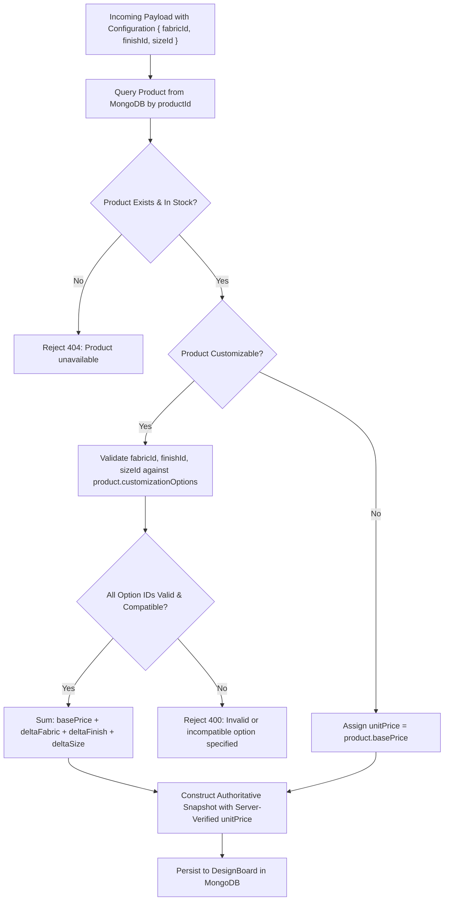

# Décora — Frontend-Backend Integration & Migration Strategy

**Document Version:** 1.1.0  
**Phase:** Phase 4, Day 13 — Complete Frontend-Backend Integration Implemented & Verified  
**Target:** Non-Invasive Adapter Migration from `localStorage` to Express REST API with Guest-to-Account Sync  

---

## 1. Migration Overview & Non-Disruption Guarantee

In Phases 1–3, the Décora frontend was designed with architectural foresight: state persistence was isolated behind service adapters (`client/src/services/designBoardService.js`, `client/src/services/api.js`, `WishlistContext.jsx`).

### Non-Disruption Guarantee:
- **Zero Component Rewrites:** UI components (`ProductDetailPage.jsx`, `CustomizerPage.jsx`, `RoomPlannerPage.jsx`, `DesignBoardsPage.jsx`, `DesignBoardDetailPage.jsx`, `BoardItemCard.jsx`, `FloorplanCanvas.jsx`) consume data strictly via React Context hooks (`useDesignBoards()`, `useWishlist()`, `useAuth()`).
- **Stable Method Signatures:** The Context APIs (`addItemToBoard`, `updateItemQuantity`, `saveRoomLayoutToBoard`, `toggleWishlist`, `isInWishlist`) maintain their exact argument signatures and return Promises.
- **Graceful Offline / Unauthenticated Fallback:** For unauthenticated guests, local storage continues to function as an offline cache. When a customer registers or logs in, their local data seamlessly merges with their database account.

---

## 2. Context & Adapter Migration Strategy

```mermaid
flowchart LR
    subgraph UI ["React Presentation Components"]
        PDP["ProductDetailPage"]
        Customizer["ProductCustomizerPage"]
        Planner["RoomPlannerPage"]
        Boards["DesignBoardsPage & Detail"]
    end

    subgraph Contexts ["React Context Layer"]
        AuthCtx["AuthContext.jsx"]
        WishlistCtx["WishlistContext.jsx"]
        BoardCtx["DesignBoardContext.jsx"]
    end

    subgraph Adapters ["Service Adapters"]
        APIClient["client/src/services/api.js (Axios)"]
        BoardService["client/src/services/designBoardService.js"]
    end

    subgraph Backend ["Express.js REST API"]
        AuthRoute["/api/v1/auth"]
        WishlistRoute["/api/v1/wishlist"]
        BoardRoute["/api/v1/boards"]
        PricingSvc["pricingService.js (Authoritative)"]
    end

    UI --> Contexts
    Contexts --> Adapters
    Adapters -->|HTTP withCredentials: true| Backend
```



### 2.1. Authentication Context (`AuthContext.jsx`)
- **Current State:** Maintains dummy `user` state and static booleans (`isAuthenticated: !!user`).
- **Integrated State:**
  - On mount, dispatches `GET /api/v1/auth/me`. If the HTTP-only cookie contains a valid JWT, populates `user = response.data.user`, setting `isAuthenticated = true` and `isAdmin = (user.role === 'admin')`. If 401, clears user silently.
  - Implements `login(credentials)` calling `POST /api/v1/auth/login`. On success, updates `user` and triggers downstream wishlist and design board refetches.
  - Implements `register(data)` calling `POST /api/v1/auth/register`.
  - Implements `logout()` calling `POST /api/v1/auth/logout`. Clears state and redirects to `/`.

### 2.2. Wishlist Context (`WishlistContext.jsx`)
- **Current State:** Reads/writes an array of string product IDs from `localStorage` (`decora_wishlist_ids`).
- **Integrated State:**
  - **Authenticated Mode:** Dispatches `GET /api/v1/wishlist` to load saved IDs from MongoDB. Toggling calls `POST /api/v1/wishlist/toggle`.
  - **Unauthenticated Mode:** Retains `localStorage` for guest browsing.
  - **Login Handshake (Guest-to-Customer Sync):** Upon successful login, dispatches `POST /api/v1/wishlist/sync` with any IDs stored in `localStorage`. The backend executes `$addToSet` to merge without duplicates, then the client clears local storage.

### 2.3. Design Board Service (`client/src/services/designBoardService.js`)
- **Current State:** Simulates asynchronous Promises using `setTimeout(..., 10)` and browser `localStorage`.
- **Integrated State:** Replace internal `readStorage()` / `writeStorage()` calls with native calls through `api.js`:
  ```javascript
  import api from './api';

  export const designBoardService = {
    async getBoards() {
      const response = await api.get('/boards');
      return response.data.data.boards;
    },

    async createBoard(boardData) {
      const response = await api.post('/boards', boardData);
      return response.data.data.board;
    },

    async getBoardById(boardId) {
      const response = await api.get(`/boards/${boardId}`);
      return response.data.data.board;
    },

    async updateBoard(boardId, updates) {
      const response = await api.patch(`/boards/${boardId}`, updates);
      return response.data.data.board;
    },

    async deleteBoard(boardId) {
      await api.delete(`/boards/${boardId}`);
      return true;
    },

    async saveBoardItem(boardId, itemSnapshot) {
      const response = await api.post(`/boards/${boardId}/items`, itemSnapshot);
      return response.data.data.board;
    },

    async updateBoardItem(boardId, boardItemId, updates) {
      const response = await api.patch(`/boards/${boardId}/items/${boardItemId}/quantity`, updates);
      return response.data.data.board;
    },

    async removeBoardItem(boardId, boardItemId) {
      const response = await api.delete(`/boards/${boardId}/items/${boardItemId}`);
      return response.data.data.board;
    },

    async saveRoomLayout(boardId, roomLayout) {
      const response = await api.put(`/boards/${boardId}/layout`, roomLayout);
      return response.data.data.board;
    },

    // Sample templates remain static local inspiration fixtures (never auto-injected into database)
    getSampleTemplates() {
      return SAMPLE_BOARD_TEMPLATES;
    }
  };
  ```

---

## 3. Server-Side Pricing Integrity Engine

### 3.1. The Principle of Non-Authoritative Client Pricing
In Day 9 and Day 10, the client implemented `pricingEngine.js` using pure additive math:
$$\text{Final Price} = \text{Base Price} + \Delta\text{Fabric} + \Delta\text{Finish} + \Delta\text{Size}$$

While the frontend calculates prices dynamically for responsive 60fps UI feedback, the backend **must never trust a price supplied by the client payload**.

### 3.2. Server Validation Flow (`server/src/services/pricingService.js`)
When saving a snapshot to a board (`POST /api/v1/boards/:id/items`) or saving a room plan (`PUT /api/v1/boards/:id/layout`):



### 3.3. Handling Edge Cases in Pricing:
1. **Invalid Option ID:** If client sends `{ fabricId: "unknown-hacked-fabric" }`, `pricingService` rejects with `400 Bad Request` listing the invalid option ID.
2. **Archived / Removed Product:** If a previously saved board references a product that was later deleted from the catalog, the board item snapshot remains valid because it is an **immutable snapshot** preserving the name, image, and price at time of saving.
3. **Price Changes on Base Catalog Piece:** If an admin updates `basePrice` of `chair-komorebi` from ₹28,000 to ₹30,000:
   - Existing design board snapshots **retain** their saved ₹28,000 price.
   - Any newly added snapshots receive the current ₹30,000 price.
   - This protects customer project quotes from retroactively breaking.

---

## 4. Database Seeding Strategy (`server/scripts/seedProducts.js` & `seedAdmin.js`)

To ensure parity between frontend datasets and the backend database, dedicated seeding utilities have been established:

### Implemented Seeding Workflows:
1. **Product Catalog Seeding (`server/scripts/seedProducts.js`):**
   - Reads the authoritative 16 furniture designs from `client/src/data/products.js`.
   - **Field Classification:** Strictly separates catalog-managed metadata (`name`, `slug`, `dimensions`, `materials`, `customizationOptions`, `basePrice`, etc.) from operational administrator-managed fields (`inStock`, `stockCount`, `featured`).
   - **Normal Mode:** Idempotent operation that checks for existing `productId` and skips already-seeded products (reports inserted, skipped, failed).
   - **Force Mode (`--force`):** Executes `findOneAndUpdate` with `$set: catalogMetadata` and `$setOnInsert: operationalDefaults`. Updates catalog design specs while preserving administrator-managed stock status, unit counts, and featured promotions without accidental overwrites.
   - **Production Safety:** Execution in `NODE_ENV=production` is strictly blocked unless the developer explicitly supplies the `--allow-prod` CLI flag. Target environment and database name are displayed cleanly without exposing credentials.
2. **Admin Provisioning (`server/scripts/seedAdmin.js`):**
   - Provisions administrative accounts with bcrypt-hashed credentials and strict input validation.
   - Preserves existing accounts without accidental overwriting.
3. **Future Seeding (Customer Demo & Boards):**
   - Sample boards with pre-populated snapshots matching Day 11 test configurations (e.g. `Minimalist Loft Suite`) will be seeded in subsequent stages.

---

## 5. Phased Implementation Roadmap (Days 12–14)

```
┌─────────────────────────────────────────────────────────────────────────────────┐
│ DAY 12: Backend Foundation, Auth & Product API Integration                      │
│ ├─ Stage 2B: Express app, MongoDB connection, centralized error handling [DONE] │
│ ├─ Stage 3: Complete Authentication, JWT cookies, role middleware [DONE]        │
│ ├─ Stage 4 Step 1: Product backend architecture & implementation plan [DONE]    │
│ ├─ Stage 4 Step 2: Product Model, REST APIs, Pricing Service & Seeding [DONE]   │
│ └─ Stage 4 Step 3: Frontend Catalog Integration & Service Adapter [DONE]        │
└─────────────────────────────────────────────────────────────────────────────────┘
                                      │
                                      ▼
┌─────────────────────────────────────────────────────────────────────────────────┐
│ DAY 13: Wishlist, Design Boards & Room Planner Backend Integration              │
│ ├─ Implement Wishlist & Design Board MongoDB models and REST endpoints         │
│ ├─ Migrate client/src/services/designBoardService.js to API adapter             │
│ ├─ Connect AuthContext and WishlistContext to live backend endpoints            │
│ └─ Build Admin Dashboard (/admin): Product CRUD & Consultation Pipeline         │
└─────────────────────────────────────────────────────────────────────────────────┘
                                      │
                                      ▼
┌─────────────────────────────────────────────────────────────────────────────────┐
│ DAY 14: End-to-End Regression, Security Audit & Academic Submission              │
│ ├─ Full-stack integration testing (Desktop & 390px Mobile Viewports)             │
│ ├─ Security verification (CORS credentials, XSS, CSRF, rate limits)             │
│ ├─ Performance & Lighthouse optimization                                         │
│ └─ Final Academic Packaging & Documentation Review                               │
└─────────────────────────────────────────────────────────────────────────────────┘
                                      │
                                      ▼
┌─────────────────────────────────────────────────────────────────────────────────┐
│ DAY 14: End-to-End Regression, Security Audit & Academic Submission              │
│ ├─ Full-stack integration testing (Desktop & 390px Mobile Viewports)             │
│ ├─ Security verification (CORS credentials, XSS, CSRF, rate limits)             │
│ ├─ Performance & Lighthouse optimization                                         │
│ └─ Final Academic Packaging & Documentation Review                               │
└─────────────────────────────────────────────────────────────────────────────────┘
```
