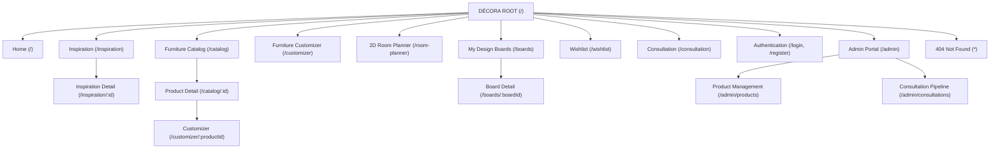

# Décora – Sitemap & Information Architecture

**Document Version:** 1.1.0  
**Phase:** Phase 2 (UI/UX Design & Asset Preparation)  
**Academic Subject:** Frontend Web Development (Primary Focus)  
**Standardized Conventions:** Currency in INR (₹), Metric units (cm / m), API prefix `/api/v1`

---

## 1. Information Architecture (IA) Overview

The information architecture of Décora is organized into four logical clusters, maintaining a strict functional separation between **Wishlist** (quick bookmarking) and **Design Boards** (thematic project planning & budget estimation):

1. **Public Discovery Cluster:** Homepage, Curated Inspiration Portfolios, Lookbook Details, Searchable Furniture Catalog, and Product Detail Pages.
2. **Interactive Personalization Cluster:** Visual Furniture Customizer, Thematic Design Boards, Customer Wishlist, and 2D SVG Room Planner.
3. **Engagement & Services Cluster:** Interior Consultation Intake Portal, Authentication (Registration/Login/Logout), and Profile.
4. **Administrative Cluster:** Protected Admin Dashboard, Product Catalog CRUD, and Consultation Pipeline Management.



---

## 2. Complete URL Route Mapping

| Route Path | View Component | Access Role | Description & Primary Actions |
|---|---|---|---|
| **`/`** | `HomePage.jsx` | Public (All) | Brand manifesto, hero banner, room category cards, featured furniture, customizer teaser, testimonials, footer. |
| **`/inspiration`** | `InspirationPage.jsx` | Public (All) | Portfolio grid of curated room designs with room type and style filter chips. |
| **`/inspiration/:id`** | `InspirationDetailPage.jsx`| Public (All) | Lookbook detail: high-res room photography, designer notes, color palette swatches, and "Shop the Look" linked products. |
| **`/catalog`** | `CatalogPage.jsx` | Public (All) | Full furniture catalog with instant text search, multi-facet filtering (room, material, style, price in ₹), and sorting. |
| **`/catalog/:id`** | `ProductDetailPage.jsx` | Public (All) | Detailed product specification: multi-angle gallery, metric dimensions ($cm$, $kg$), care notes, and direct "Customize" CTA. |
| **`/customizer`** | `CustomizerPage.jsx` | Public (All) | Standalone customizer with default featured piece loaded, ready for material/finish and size adjustments. |
| **`/customizer/:productId`**| `CustomizerPage.jsx` | Public (All) | Customizer pre-loaded with specific piece; authentic swatches, additive price calculation, reset, and save. |
| **`/room-planner`** | `RoomPlannerPage.jsx` | Customer / Guest | React-managed SVG 2D floorboard: room dimension setup ($m$), furniture palette, drag/drop, rotation, and live budget tally in ₹. |
| **`/wishlist`** | `WishlistPage.jsx` | Authenticated (`customer`)| Dedicated personal bookmark queue: quick-saved furniture pieces, stock availability status, instant remove toggle, and direct links to customize. |
| **`/boards`** | `DesignBoardsPage.jsx` | Authenticated (`customer`)| Index of personal thematic design boards (e.g., "Living Room Japandi 2026") showing item count and aggregated room budget estimate in INR (₹). |
| **`/boards/:id`** | `DesignBoardDetailPage.jsx`| Authenticated (`customer`)| Detailed board canvas: full list of configured furniture items, personal notes, cost breakdown, and attach-to-consultation action. |
| **`/consultation`** | `ConsultationPage.jsx` | Public (Dual Intake) | Multi-step design consultation form. Unauthenticated guests provide contact details; registered customers have data pre-filled. |
| **`/login`** | `LoginPage.jsx` | Public (Guest only) | Customer and administrator login form with client validation and secure HTTP-only cookie issuance. |
| **`/register`** | `RegisterPage.jsx` | Public (Guest only) | Account registration form with password strength checks and automatic login redirection. |
| **`/admin`** | `AdminDashboard.jsx` | Role: `admin` | Protected dashboard summary metrics (total products, registered users, pending consultations). |
| **`/admin/products`** | `AdminProducts.jsx` | Role: `admin` | Full CRUD data table: add new furniture piece, edit specs/pricing, toggle availability, and delete records. |
| **`/admin/consultations`**| `AdminConsultations.jsx`| Role: `admin` | Filterable consultation pipeline: review client requirements and advance status (`New` $\rightarrow$ `Contacted` $\rightarrow$ `Completed`). |
| **`*` (Catch-all)** | `NotFoundPage.jsx` | Public (All) | Accessible 404 page with warm architectural styling, clear error message, and direct link back to `/catalog` or `/`. |

---

## 3. Clear Separation: Wishlist vs. Design Boards

To prevent confusion between bookmarking and project planning, Décora maintains a strict functional distinction:

```
┌────────────────────────────────────────────────────────────────────────┐
│               WISHLIST vs. DESIGN BOARDS SPECIFICATION                 │
├───────────────────────────────┬────────────────────────────────────────┤
│ Feature: Wishlist (/wishlist) │ Feature: Design Boards (/boards)       │
├───────────────────────────────┼────────────────────────────────────────┤
│ • Flat, single-tier queue     │ • Multi-board project structure        │
│   of bookmarked products.     │   (e.g., "Living Room", "Study").      │
│ • One-click heart toggle      │ • Curated aesthetic moodboard          │
│   from any catalog card.      │   pairing furniture and room styles.   │
│ • Displays base product info  │ • Retains discrete custom snapshot     │
│   and live stock availability.│   (chosen fabric, finish, size, price).│
│ • Fast personal bookmarking   │ • Aggregates total estimated design    │
│   for later comparison.       │   budget across all items in INR (₹).  │
│ • No budget calculations.     │ • Can be attached directly to a        │
│                               │   Design Consultation inquiry.         │
└────────────────────────────────┴────────────────────────────────────────┘
```

---

## 4. Core User Journey Flows

### Journey 1: Inspiration-to-Customization Discovery (Guest & Customer)
```text
1. User enters Homepage (/) -> Clicks "Explore Inspiration" (/inspiration).
2. Filters by Style: "Japandi" and Room: "Living Room".
3. Opens "Komorebi Living Space" (/inspiration/komorebi-living).
4. Inspects lookbook concept and reviews "Shop the Look" section.
5. Clicks "Customize This Piece" on the Komorebi Lounge Chair.
6. Lands on Customizer (/customizer/chair-01) with chair pre-loaded.
7. Toggles fabric to "Cream Bouclé" (+₹3,500) and finish to "Natural Oak" (+₹2,000).
8. Real-time dynamic price updates from ₹28,000 to ₹33,500.
9. Clicks "Save to Board" -> If guest, prompts login modal; if logged in, adds to "Living Room Refresh".
```

### Journey 2: Spatial Room Planning & Budget Aggregation
```text
1. Logged-in Customer navigates to Room Planner (/room-planner).
2. Defines room dimensions: Length = 4.5m, Width = 3.8m.
3. React-managed SVG canvas generates proportional grid floorboard.
4. Opens furniture palette sidebar -> Selects "3-Seater Minimalist Sofa".
5. Drags sofa onto SVG grid -> Rotates 90° to face accent wall.
6. Adds "Walnut Coffee Table" and "Lounge Chair".
7. Live budget widget calculates aggregated total: ₹84,500.
8. Clicks "Save Room Plan" -> Layout coordinates persist to /api/v1/room-plans.
```

### Journey 3: Wishlist Quick-Save with Login Action Preservation
```text
1. Unauthenticated Guest browses catalog (/catalog).
2. Clicks heart icon on "Sylvan Minimalist Sofa".
3. System saves intended action to session (`redirect=/catalog?action=wishlist&productId=sofa-01`).
4. Guest is directed to Login (/login).
5. Upon successful authentication, guest is returned to /catalog and the sofa is automatically added to their wishlist with an instant confirmation toast.
```

### Journey 4: Design Consultation Intake (Dual Pathway)
```text
Pathway A (Guest):
1. Guest navigates to /consultation.
2. Step 1: Enters Name, Email, and Phone number.
3. Step 2: Selects Room Type ("Master Bedroom") and Preferred Style ("Scandinavian").
4. Step 3: Selects INR Budget Bracket ("₹1,00,000 – ₹3,00,000") and inputs dimensions (4m x 3.5m).
5. Step 4: Submits form -> Stored in MongoDB with status: "New" -> Confirmation screen with reference #DEC-7821.

Pathway B (Customer):
1. Customer is logged in and navigates to /consultation.
2. Contact details are pre-filled automatically from session profile.
3. Attaches saved Design Board: "Master Bedroom Japandi".
4. Submits with 1-click -> Request linked directly to customer's account in database.
```
