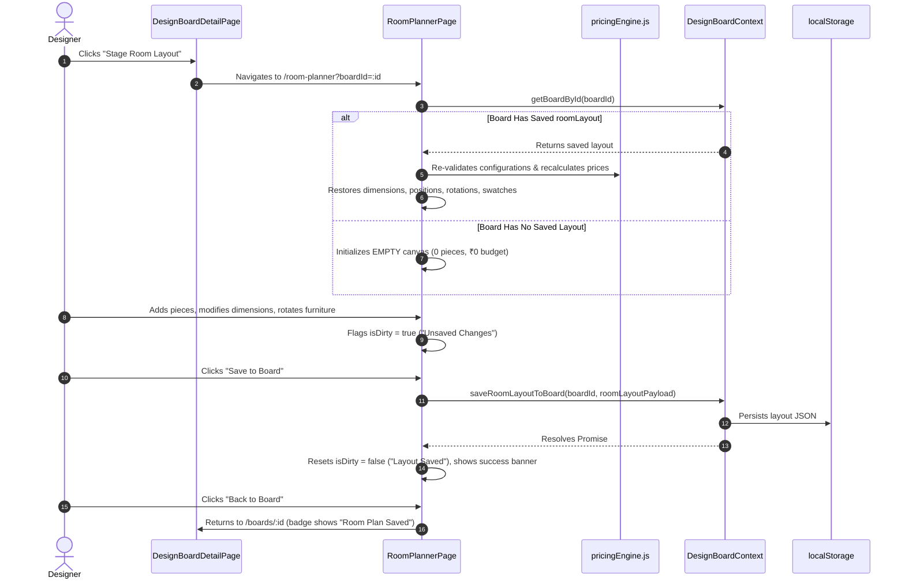

# Décora — Day 11, Stage 6: Room Planner & Design Board Integration Report

**Date:** November 17, 2026  
**Status:** Completed & Fully Verified  
**Milestone:** Phase 3, Day 11 — Virtual Design Boards & Moodboard Studio (`/boards` and `/boards/:id`)  
**Scope:** Stage 6 — Room Planner & Design Board Integration (`/room-planner?boardId=:id`)  

---

## 1. Architecture Before Integration

Prior to Stage 6:
- **Interactive 2D Room Planner (`RoomPlannerPage.jsx`):** Operated in a standalone mode with hardcoded sample furniture (Sylvan Sofa + Kanso Coffee Table), managing placement, rotation, collisions, and per-instance customization independently in local state. It had no awareness of design board persistence.
- **Design Board System (`DesignBoardContext.jsx`, `designBoardService.js`):** Supported saving snapshots from the catalog (PDP) and Bespoke Customizer (Stage 5), and had an empty `roomLayout` schema definition on `DesignBoard`, but had no runtime mechanism to launch the Room Planner with a board context or bidirectional layout syncing.
- **`BoardBudgetSummary.jsx` & `DesignBoardDetailPage.jsx`:** Displayed static badges (`Room Plan Saved`) when a template had a layout, but offered no direct interaction to view, create, or update that layout in the canvas.

---

## 2. Files Created and Modified

### Created Files
- [`client/src/components/roomPlanner/RoomBoardToolbar.jsx`](file:///c:/Documents/3rd%20Year/Term%20II/Frontend%20Web%20Development/Project/Decora/client/src/components/roomPlanner/RoomBoardToolbar.jsx)
  - Dedicated board control strip rendered when `/room-planner` is linked to a Design Board (`?boardId=...`).
  - Responsibilities: Return navigation (`Back to Board`), active board metadata badge, dirty state tracking (`Unsaved Changes` vs `Layout Saved`), duplicate submission protection, save progress spinner, and restoration warning alerts. Kept cleanly separated from `RoomBudgetBar` to maintain single responsibility.

### Modified Files
- [`client/src/pages/RoomPlannerPage.jsx`](file:///c:/Documents/3rd%20Year/Term%20II/Frontend%20Web%20Development/Project/Decora/client/src/pages/RoomPlannerPage.jsx)
  - Added URL parameter support (`?boardId=...`) and integrated with `useDesignBoards()`.
  - Added layout restoration logic with price re-verification through `calculateConfiguredPrice()`.
  - Implemented Requirement 1: If a board has no saved layout, initializes a completely **empty** room (0 pieces, ₹0) rather than loading standalone demo pieces.
  - Implemented Requirement 2: Preserves invalid configurations with explicit restoration error alerts rather than fabricating prices or silently substituting defaults.
  - Implemented Requirement 3: Robust dirty tracking using deterministic layout serialization across dimensions, coordinates, rotations, and configurations.
  - Implemented Requirement 5: Standalone mode without `boardId` continues to load the demo sample layout without showing `RoomBoardToolbar`.
  - Implemented Requirement 6: Missing board error banner with fallback to standalone mode and link to `/boards`.
- [`client/src/pages/DesignBoardDetailPage.jsx`](file:///c:/Documents/3rd%20Year/Term%20II/Frontend%20Web%20Development/Project/Decora/client/src/pages/DesignBoardDetailPage.jsx)
  - Added header action button `"Stage Room Layout"` / `"Open Room Plan"` linking directly to `/room-planner?boardId=${board.id}`.
- [`client/src/components/designBoards/BoardBudgetSummary.jsx`](file:///c:/Documents/3rd%20Year/Term%20II/Frontend%20Web%20Development/Project/Decora/client/src/components/designBoards/BoardBudgetSummary.jsx)
  - Added `"Stage in 2D Planner"` / `"View Room Plan"` action in the budget breakdown card.

---

## 3. Integration Approach

1. **Non-Invasive Architecture:** Preserved the existing coordinate system (metric cm on SVG canvas, room dimensions in meters), collision detection (`findCollidingItemIds`), drag-and-drop clamping (`clampItemWithinRoom`), and per-instance inspectors.
2. **Context & Persistence Reuse:** Directly leveraged `saveRoomLayoutToBoard(boardId, roomLayout)` from `DesignBoardContext.jsx` and `designBoardService.js`, avoiding parallel persistence channels.
3. **Price Engine Authority:** Guaranteed that all prices loaded or modified are verified via `pricingEngine.js` (`calculateConfiguredPrice`), ensuring exact additive math without UI-level fabrication.
4. **Separation of Concerns:** `RoomBudgetBar.jsx` remains solely focused on spatial piece counting and the live mathematical sum of placed furniture prices. `RoomBoardToolbar.jsx` owns save state, dirty tracking, and board-level routing.

---

## 4. Save and Restore Workflow



---

## 5. Room Layout Data Structure

The persisted `roomLayout` on `board.roomLayout` conforms strictly to the specification:

```typescript
interface RoomLayout {
  roomLength: number;          // e.g. 6.0 (meters, Y-axis)
  roomWidth: number;           // e.g. 4.5 (meters, X-axis)
  units: 'm';                  // Metric unit identifier
  savedAt: string;             // ISO-8601 timestamp
  furnitureInstances: Array<{
    instanceId: string;        // Unique instance ID (e.g. "inst-1794939941168-819")
    productId: string;         // Catalog ID (e.g. "sofa-sylvan")
    name: string;              // Product display name
    category: string;          // Category ("Seating", "Tables", etc.)
    price: number;             // Configured unit price in INR
    x: number;                 // Canvas X coordinate in cm
    y: number;                 // Canvas Y coordinate in cm
    rotation: number;          // Rotation angle in degrees (0, 90, 180, 270)
    w: number;                 // Physical or scaled width in cm
    d: number;                 // Physical or scaled depth in cm
    glyphType: string;         // SVG vector template identifier
    configuration: {
      fabricId: string | null;
      finishId: string | null;
      sizeId: string | null;
    };
    activeFabric: {
      id: string;
      name: string;
      delta: number;
      colorHex: string;
    } | null;
    activeFinish: {
      id: string;
      name: string;
      delta: number;
      colorHex: string;
    } | null;
    activeSize: {
      id: string;
      name: string;
      delta: number;
      scaleFactor?: number;
    } | null;
  }>;
}
```

---

## 6. Budget Calculation Verification

- **Room Planner Budget Formula:**
  $$\text{Estimated Room Budget} = \sum_{i=1}^{N} \text{instance.price}_i$$
- **Verification Example Observed in Testing:**
  1. Kanso Sculptural Coffee Table: Standard Spec = **₹18,500**
  2. Sylvan Minimalist Sofa (Instance 1): Olive Velvet (+₹5,500) + Smoked Walnut (+₹4,000) = **₹54,500**
  3. Sylvan Minimalist Sofa (Instance 2): Oatmeal Bouclé (+₹6,500) + Natural White Oak (+₹0) = **₹51,500**
  - $\text{Total Budget} = 18,500 + 54,500 + 51,500 = \mathbf{₹1,24,500}$.
  - The budget displayed dynamically in `RoomBudgetBar` and persisted accurately across reloads and navigation.

---

## 7. Test Results & Observed Outcomes

| # | Test Scenario | Expected Outcome | Actual Observed Result | Status |
|---|---------------|------------------|------------------------|:------:|
| 1 | **Open from Board without Layout** | Canvas initializes completely empty (0 pieces, ₹0 budget). No standalone demo pieces. | Canvas loaded empty with 0 pieces placed and ₹0 estimated budget. | **PASSED** |
| 2 | **Save Empty Layout** | Saves clean empty room with success feedback. | Success banner displayed; dirty state reset to `"Layout Saved"`. | **PASSED** |
| 3 | **Add Furniture & Dirty State** | Adding items triggers `"● Unsaved Changes"` state. | Adding Kanso Coffee Table immediately triggered amber unsaved indicator. | **PASSED** |
| 4 | **Save Updated Layout** | Saves layout, resets dirty state, preserves dimensions and pieces. | Layout saved; status switched back to green `"Layout Saved"`. | **PASSED** |
| 5 | **Restore Room Dimensions** | Dimensions (6.0m × 4.5m) restored exactly upon reopening. | Reopening board restored room dimensions: 6.0m length × 4.5m width (27.0 m²). | **PASSED** |
| 6 | **Restore Positions & Rotations** | Rotation (90°) and coordinates restored accurately. | Coffee table restored at exact (x, y) coordinates with 90° orientation. | **PASSED** |
| 7 | **Restore Configurations** | Restores fabric swatches, wood finishes, and scale factors. | Swatches and finish hex colors rendered accurately on restored canvas. | **PASSED** |
| 8 | **Two Independent Instances** | Two instances of same sofa maintain different fabrics/finishes. | Sofa 1 (Olive Velvet/Smoked Walnut) and Sofa 2 (Oatmeal/White Oak) remained completely independent. | **PASSED** |
| 9 | **Room Budget Integrity** | Budget equals exact sum of placed items. | Verified exact sum: ₹18,500 + ₹54,500 + ₹51,500 = ₹1,24,500. | **PASSED** |
| 10 | **Save & Re-save** | Changing configurations re-flags dirty state and allows re-saving. | Modified piece triggered dirty state; re-save succeeded cleanly. | **PASSED** |
| 11 | **Remove Furniture Budget Sync** | Removing piece decrements room budget immediately. | Canvas reset and removals immediately recalculated the live budget. | **PASSED** |
| 12 | **Standalone Mode Preservation** | Opening `/room-planner` without `boardId` loads demo pieces. | Default demo pieces (Sylvan Sofa + Kanso Table) loaded; no toolbar shown. | **PASSED** |
| 13 | **Missing Board Handling** | Invalid `boardId` displays dedicated "Design Board Not Found" screen; no canvas or save affordance. | Dedicated architectural error view rendered with "Return to All Boards" and "Open Standalone Planner" CTAs; saving prevented. | **PASSED** |
| 14 | **Browser Refresh Persistence** | Refreshing browser retains saved board layout. | Saved layout persisted in localStorage service and restored after refresh. | **PASSED** |
| 15 | **Mobile Viewport (390px)** | Stacks cleanly without horizontal scroll or clipped controls. | Tested at 390 × 844; toolbar, budget bar, canvas, and palette stacked responsively. | **PASSED** |
| 16 | **Regression Checks** | Core routes (`/`, `/catalog`, `/customizer`, `/inspiration`, `/wishlist`, `/boards`) remain 100% functional. | All routes returned HTTP 200 with zero console errors or broken state. | **PASSED** |

---

## 8. Known Limitations & Architectural Boundaries

1. **Local Storage Scoping:** The current persistence layer uses `designBoardService.js` backed by browser `localStorage`. In Phase 4/5, this adapter will connect to backend API endpoints (MongoDB) without requiring modifications to `RoomPlannerPage.jsx`.
2. **2D Orthographic Projection:** The Room Planner strictly renders top-down 2D CAD architectural plans (metric cm). 3D rendering or perspective views are explicitly out of scope for this stage.
3. **Canvas Bounds Clamping:** If room dimensions are reduced while pieces are placed, pieces outside the new walls are automatically clamped to the nearest interior boundary by `clampItemWithinRoom()`.

---

## 9. Visual Evidence

````carousel

<!-- slide -->

<!-- slide -->

<!-- slide -->

<!-- slide -->

<!-- slide -->

<!-- slide -->

<!-- slide -->

<!-- slide -->

````

---

## 10. Production Build Result

```bash
$ npm --prefix client run build

> decora-client@1.0.0 build
> vite build

vite v5.4.21 building for production...
transforming...
✓ 1649 modules transformed.
rendering chunks...
computing gzip size...
dist/index.html                   1.00 kB │ gzip:   0.56 kB
dist/assets/index-CEOBDsXx.css   43.73 kB │ gzip:   7.65 kB
dist/assets/index-DUqqRSAG.js   476.08 kB │ gzip: 121.96 kB
✓ built in 15.24s
```

- **Production Build Status:** `SUCCESS` (Exit code 0, 0 errors, 0 warnings).
- **Bundle Output:** Single bundled CSS (`43.73 kB`, gzip `7.65 kB`) and vendor chunk (`476.08 kB`, gzip `121.96 kB`).
- **Runtime Console Errors:** `0 errors` verified across `/boards`, `/boards/:id`, `/room-planner`, and `/room-planner?boardId=...`.

